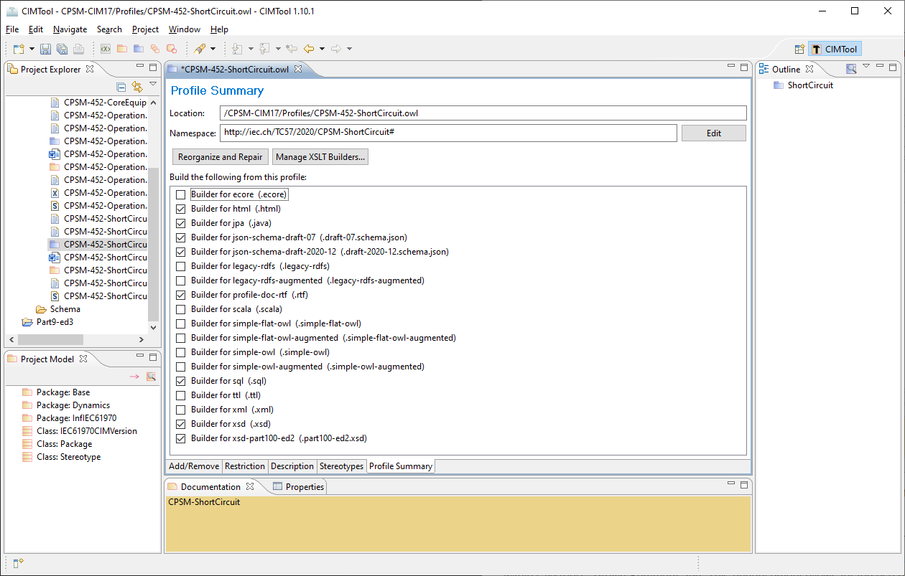
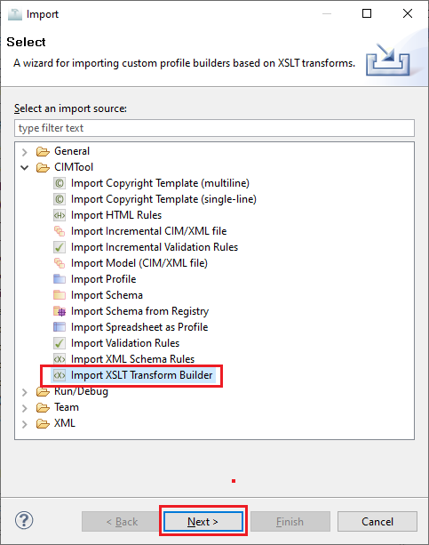
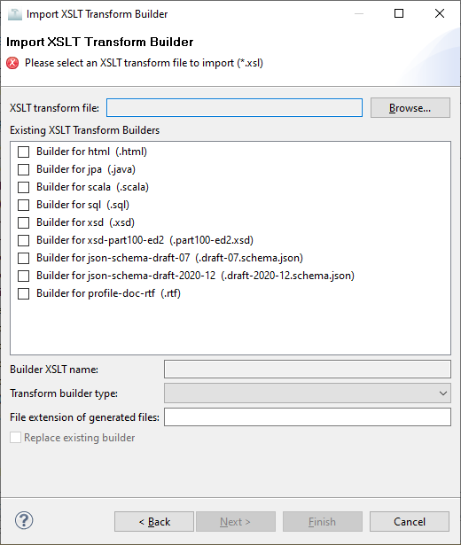
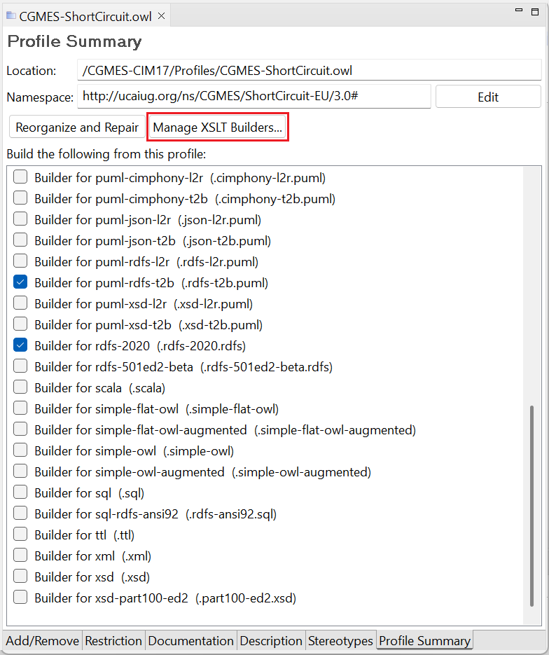
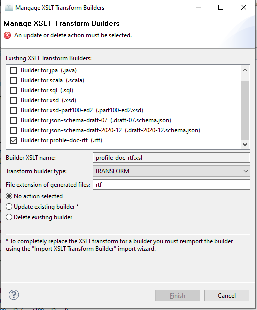
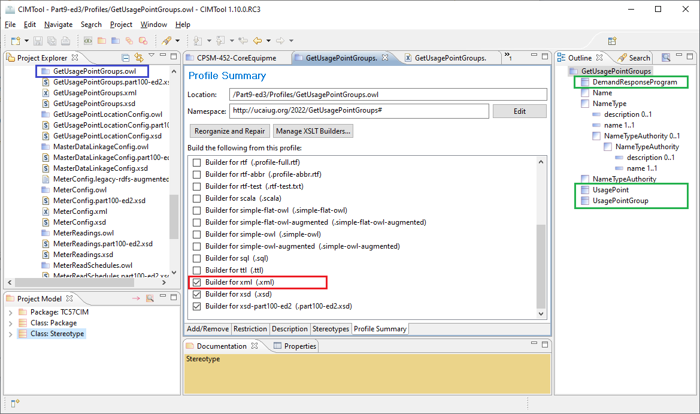

<h1 id="cimtool-builders-library"></h1>

This is the official UCAIug repository for custom **CIMTool** [XSLT](https://www.w3schools.com/xml/xsl_intro.asp) builders and is provided as a public space to create, collaborate and contribute back builders for the benefit of the **CIMTool** community at large.  This library of builders can be used in [CIMTool](https://cimtool.ucaiug.io/) to generate various types of target artifacts from a **CIMTool** profile definition.  

Would you like a custom builder that generates C/C++ objects from your CIMTool profiles? Perhaps you've wished there was a builder to create [Apache Avro](https://avro.apache.org/) schemas for data serialization or one that would automatically generate a [Google Protocol Buffers](https://developers.google.com/protocol-buffers/docs/overview) `.proto` file?  You can now with **CIMTool**'s custom builder import feature.

Included in this library is the base set of XSLT transforms that come shipped with **CIMTool**. These have been included to serve as examples or starting points that can be either extended or used as working examples when creating new XSLT builders.

Feel free to initiate a [discussion](https://github.com/cimug-org/CIMTool-Builders-Library/discussions) around a new idea for a custom builder or to post a question on the discussions board. Please contribute new builders to this library using the submission process outlined towards the end of this page.

## Current Library of Builders

#### Builders Shipped with CIMTool:

The builders below ship with CIMTool 2.3.0, in the order CIMTool registers them (```builders.json```).

| XSLT Builder | Output Type | Description |
|------------------|------------------|------------------|
| [html.xsl](shipped-builders/html/builder.md) | HTML file | The **html.xsl** builder generates a standalone HTML file containing the complete documentation for all classes, attributes and associations defined in a profile. |
| [jpa.xsl](shipped-builders/jpa/builder.md) | Java source file | The **jpa.xsl** builder generates a Java source file (`*.java`) containing JPA classes compatible with Jakarta Persistence 3.1 (Jakarta EE 10). The defined JPA classes can be utilized in Java applications for persisting profiles to a database. |
| [jpa-rdfs.xsl](shipped-builders/jpa-rdfs/builder.md) | Java source file | The **jpa-rdfs.xsl** builder generates a Java source file (`*.java`) containing JPA classes compatible with Jakarta Persistence 3.1 (Jakarta EE 10) for RDFS profiles such as CGMES, matching the database schema generated by the **sql-rdfs-ansi92.xsl** builder. |
| [scala.xsl](shipped-builders/scala/builder.md) | Scala source file | The **scala.xsl** builder produces a Scala source file (`*.scala`) that defines a vocabulary for a profile definition. These source files contain Scala classes/objects representative of those in the profile and may be used in applications implemented in the Scala programming language. |
| [sql.xsl](shipped-builders/sql/builder.md) | SQL DDL file | The **sql.xsl** builder generates an ANSI SQL-compliant DDL (Data Definition Language) script (`*.sql`) that can be used to create the database tables and fields corresponding to the classes and attributes represented in a profile. |
| [sql-rdfs-ansi92.xsl](shipped-builders/sql-rdfs-ansi92/builder.md) | SQL DDL file | The **sql-rdfs-ansi92.xsl** builder generates an ANSI SQL-92 compliant DDL script (`*.sql`) for RDFS profiles such as CGMES, giving classes outside the IdentifiedObject hierarchy a surrogate primary key. |
| [xsd.xsl](shipped-builders/xsd/builder.md) | XSD schema | The **xsd.xsl** builder generates an XSD schema that is compliant with the [IEC 62361-100:2016](https://webstore.iec.ch/publication/25114) (CIM Profiles to XML Schema Mapping) standard. Additionally, these schemas are compatible with the [IEC 61968-100:2013](https://webstore.iec.ch/publication/6198) (Implementation Profiles) standard used for enterprise integration. |
| [xsd-part100-ed2.xsl](shipped-builders/xsd-part100-ed2/builder.md) | XSD schema | This builder is similar to the xsd.xsl builder above in that it also generates an XSD schema that is compliant with **IEC 62361-100:2016**.  However, these generated schemas are uniquely compatible with the new [IEC 61968-100:2022](https://webstore.iec.ch/publication/67766) published standard which is not backwards compatible with [IEC 61968-100:2013](https://webstore.iec.ch/publication/6198). |
| [json-schema-draft-07.xsl](shipped-builders/json-schema-draft-07/builder.md) | JSON schema | The **json-schema-draft-07.xsl** builder generates a JSON schema compliant with the draft **IEC 62361-104** standard (CIM Profiles to JSON schema Mapping). The version of the JSON schema specification that the schema conforms to is draft-07. |
| [json-schema-draft-2020-12.xsl](shipped-builders/json-schema-draft-2020-12/builder.md) | JSON schema | The **json-schema-draft-2020-12.xsl** builder generates a JSON schema compliant with the draft **IEC 62361-104** standard (CIM Profiles to JSON schema Mapping). The version of the JSON schema specification that the schema conforms to is draft-2020-12. |
| [profile-doc-rtf.xsl](shipped-builders/profile-doc-rtf/builder.md) | Microsoft Word file | The **profile-doc-rtf.xsl** builder produces a Microsoft Word compatible RTF (Rich Text Format) document that contains the complete documentation for all classes, attributes and associations defined in a profile. |
| [rdfs-2020.xsl](shipped-builders/rdfs-2020/builder.md) | RDFS schema | This **rdfs-2020.xsl** builder generates RDFS2020 compliant schemas that reflect that latest de facto agreements on extensions post [IEC 61970-501:2006](https://webstore.iec.ch/publication/6215). |
| [linkml.xsl](shipped-builders/linkml/builder.md) | LinkML schema (YAML) | The **linkml.xsl** builder generates a [LinkML](https://linkml.io/) schema (`*.linkml.yaml`) representing the profile. |
| [cimantic-graphs.xsl](shipped-builders/cimantic-graphs/builder.md) | Python source file | The **cimantic-graphs.xsl** builder produces a specialized python dataclass schema to be used as input into the CIMantic Graphs open source library for creating, parsing, and editing CIM power system models using in-memory knowledge graphs. |
| [cimantic-graphs-init.xsl](shipped-builders/cimantic-graphs/builder.md) | Python source file | This builder is intended to be used in conjunction with the **cimantic-graphs.xsl** builder and is responsible for generating the `python __init__.py` file required for library imports to work correctly. |
| [rdfs-501ed2-beta.xsl](shipped-builders/rdfs-501ed2-beta/builder.md) | RDFS schema (beta) | The **rdfs-501ed2-beta.xsl** builder is a reference implementation of the RDFS schema defined by the draft IEC 61970-501 Ed 2.0 specification. |
| [puml-rdfs-t2b.xsl](shipped-builders/puml-rdfs-t2b/builder.md) | PlantUML class diagram | The **puml-rdfs-t2b.xsl** builder produces a PlantUML class diagram representing the profile (for an RDFS schema) that this builder is executed on. The layout of the diagram is top-to-bottom (i.e. t2b). |
| [puml-rdfs-l2r.xsl](shipped-builders/puml-rdfs-l2r/builder.md) | PlantUML class diagram | The **puml-rdfs-l2r.xsl** builder produces a PlantUML class diagram representing the profile (for an RDFS schema) that this builder is executed on. The layout of the diagram is left-to-right (i.e. l2r). |
| [puml-xsd-t2b.xsl](shipped-builders/puml-xsd-t2b/builder.md) | PlantUML class diagram | The **puml-xsd-t2b.xsl** builder produces a PlantUML class diagram representing the profile (for an XSD schema) that this builder is executed on. The layout of the diagram is top-to-bottom (i.e. t2b). |
| [puml-xsd-l2r.xsl](shipped-builders/puml-xsd-l2r/builder.md) | PlantUML class diagram | The **puml-xsd-l2r.xsl** builder produces a PlantUML class diagram representing the profile (for an XSD schema) that this builder is executed on. The layout of the diagram is left-to-right (i.e. l2r). |
| [puml-json-t2b.xsl](shipped-builders/puml-json-t2b/builder.md) | PlantUML class diagram | The **puml-json-t2b.xsl** builder produces a PlantUML class diagram representing the profile (for a JSON schema) that this builder is executed on. The layout of the diagram is top-to-bottom (i.e. t2b). |
| [puml-json-l2r.xsl](shipped-builders/puml-json-l2r/builder.md) | PlantUML class diagram | The **puml-json-l2r.xsl** builder produces a PlantUML class diagram representing the profile (for a JSON schema) that this builder is executed on. The layout of the diagram is left-to-right (i.e. l2r). |
| [adoc-article-json.xsl](shipped-builders/adoc-article-json/builder.md) | AsciiDoc document | The **adoc-article-json.xsl** builder generates documentation for a JSON schema profile as a standalone AsciiDoc article, including the profile's PlantUML diagram (`*.json-l2r.puml`). |
| [adoc-inline-json.xsl](shipped-builders/adoc-inline-json/builder.md) | AsciiDoc document | The **adoc-inline-json.xsl** builder generates documentation for a JSON schema profile as AsciiDoc content for inclusion in a larger document, including the profile's PlantUML diagram (`*.json-l2r.puml`). |
| [adoc-article-xsd.xsl](shipped-builders/adoc-article-xsd/builder.md) | AsciiDoc document | The **adoc-article-xsd.xsl** builder generates documentation for an XSD profile as a standalone AsciiDoc article, including the profile's PlantUML diagram (`*.xsd-l2r.puml`). |
| [adoc-inline-xsd.xsl](shipped-builders/adoc-inline-xsd/builder.md) | AsciiDoc document | The **adoc-inline-xsd.xsl** builder generates documentation for an XSD profile as AsciiDoc content for inclusion in a larger document, including the profile's PlantUML diagram (`*.xsd-l2r.puml`). |
| [adoc-article-rdfs.xsl](shipped-builders/adoc-article-rdfs/builder.md) | AsciiDoc document | The **adoc-article-rdfs.xsl** builder generates documentation for an RDFS profile as a standalone AsciiDoc article, including the profile's PlantUML diagram (`*.rdfs-t2b.puml`). |
| [adoc-inline-rdfs.xsl](shipped-builders/adoc-inline-rdfs/builder.md) | AsciiDoc document | The **adoc-inline-rdfs.xsl** builder generates documentation for an RDFS profile as AsciiDoc content for inclusion in a larger document, including the profile's PlantUML diagram (`*.rdfs-t2b.puml`). |
| [adoc-article-rdfs-mappings.xsl](shipped-builders/adoc-article-rdfs-mappings/builder.md) | AsciiDoc document | The **adoc-article-rdfs-mappings.xsl** builder is a variant of the **adoc-article-rdfs.xsl** builder that adds a mapping column to the member tables. |
| [adoc-inline-rdfs-mappings.xsl](shipped-builders/adoc-inline-rdfs-mappings/builder.md) | AsciiDoc document | The **adoc-inline-rdfs-mappings.xsl** builder is a variant of the **adoc-inline-rdfs.xsl** builder that adds a mapping column to the member tables. |
| [csharp-ef-rdfs.xsl](shipped-builders/csharp-ef-rdfs/builder.md) | C# source file | The **csharp-ef-rdfs.xsl** builder generates a C# source file (`*.cs`) containing Entity Framework Core entity classes for RDFS profiles such as CGMES, matching the database schema generated by the **sql-rdfs-ansi92.xsl** builder. |
| [apache-avro-schema-beta.xsl](shipped-builders/apache-avro-schema-beta/builder.md) | Apache Avro schema (beta) | The **apache-avro-schema-beta.xsl** builder generates an [Apache Avro](https://avro.apache.org/) schema (`*.avsc`) for a profile. |

#### Community Developed Builders:

| XSLT Builder | Output Type | Description |
|------------------|------------------|------------------|
| [json-schema-draft-07-jsonschema2pojo.xsl](custom-builders/json-schema-draft-07-jsonschema2pojo/builder.md) | Specialized JSON schema |  The **json-schema-draft-07-jsonschema2pojo.xsl** builder produces a specialized JSON schema to be used as input into the jsonschema2pojo open source Maven or Gradle build plugins to generate annotated Java classes for data-binding with Jackson 2.x or Gson. This custom builder was derived from the **json-schema-draft-07.xsl** builder and is intended to serve as a companion builder to it. |
| [json-schema-draft-2020-12-jsonschema2pojo.xsl](custom-builders/json-schema-draft-2020-12-jsonschema2pojo/builder.md) | Specialized JSON schema | The **json-schema-draft-2020-12-jsonschema2pojo.xsl** builder produces a specialized JSON schema to be used as input into the jsonschema2pojo open source Maven or Gradle build plugins to generate annotated Java classes for data-binding with Jackson 2.x or Gson. This custom builder was derived from the **json-schema-draft-2020-12.xsl** builder and is intended to serve as a companion builder to it. |

## Background
**CIMTool** ships with a variety of different types of builders that generate artifacts based on a profile. Examples of existing builders include those that generate XSD schemas, JPA Java source code, RDBMS DDL scripts, RDFS profiles, and RTF Word docs among others.

A subcategory of builders supported by **CIMTool** are those that are based on XSLT transforms. In the below screenshot the builders that are selected are those that generate target files using XSLT transforms (click the image to enlarge):

[](https://raw.githubusercontent.com/cimug-org/CIMTool-Builders-Library/main/readme-icons/cimtool-profile-summary-tab.png)

Starting with the **CIMTool.1.10.0.RC1** release, the ability to import and configure custom user-defined XSLT transforms and have them automatically added to the list of builders was introduced. This new feature opened up a wide range of possibilities for end users to more easily extend the builder capabilities beyond that shipped with the product. No longer do you need to know Eclipse plugin development.

CIMTool's internal XSLT processor was originally the [Apache Xalan](https://xalan.apache.org/) project that shipped as part of the Java JDK/JRE.  Xalan, however, is a W3C [XSLT 1.0](https://www.w3.org/TR/xslt-10/) compliant XSLT processor.  To support the much richer feature sets defined in the [XSLT 2.0](https://www.w3.org/TR/xslt-20/) and [XSLT 3.0](https://www.w3.org/TR/xslt-30/) specifications the XSLT processing engine was replaced by  [Saxon HE 10.8](https://saxonica.com/html/documentation10/about/index.html) in the **CIMTool.1.10.0** production release.

The screenshots below illustrate how to access the new import and maintenance screens (click on the images to present a larger view):

From the "Import" wizards screen... | ...Launch the "Import XSLT Transform Builder" screen
---------|---------
[](readme-icons/import-wizard.png) | [](readme-icons/import-xslt-transform-builder.png)

From the "Profile Summary" tab... | ...Launch the "Manage XSLT Transform Builders" screen
---------|---------
[](readme-icons/profile-summary-manage-builders.png) | [](readme-icons/manage-xslt-transform-builders.png)


## How XSLT Builders Work

The diagram below shows how **CIMTool** generates an artifact from a profile using an XSLT builder. It is taken from the [Avro4CIM case study](https://github.com/cimug-org/Avro4CIM/blob/main/case-study/README.md), where the generated artifact is an Apache Avro schema, but every XSLT builder follows the same path:

- The UML model is imported into **CIMTool** and is referred to as the "schema", representing the full canonical model. The schema formats supported by **CIMTool** are ```.xmi``` (XML Metadata Interchange) and EA project files of the following types: ```.eap```, ```.eapx```, ```.qea``` and ```.qeap```.
- The OWL ontology (```.owl```) is the formal profile definition. It is derived from the canonical CIM using the **CIMTool** user interface.
- For the purposes of XSLT transformation, a corresponding internal XML format is created from the OWL that is optimized for transformation into other downstream formats. This internal XML is not typically visible to an end user but is the input to every XSLT builder.
- The XSLT builder transforms the internal XML into the final artifact, in this example an Apache Avro schema (```.avsc```).

![CIMTool workflow: UML to Apache Avro schema](https://img.plantuml.biz/plantuml/svg/fLVVR-8u47xFNp5g7xP5eWhzmNMhQhKKajsUe5IbT-r3fSe40xucTcGxKFPqzxVVs92Ga0IrElfGy7pZ-URpU3BvhZIHEeb2HuiOj82nq5f4C66I1fe9xipPX0ADOhs2YEgvc2Z7-G8_gQImf40cVoLAWvvJc0l9VWckIGWg9W7ZCvWA2MEgDPLcIJCqISedL1hZaN6w3mdNVmpwCA5JaeGQc89_JzrZHxqn7XD98k1YGXMDeUMwrO4NL6eM_F-mPuMmal2tD6nk-OO4RpCf4ZxfYX3Z7FhsaqEeEPc8fUL1GaLpbeUrc-H8x2A_fv18RhFV-SLv-pnlxKWfbdL67mNVs5pxoNCDGg8K_Eq0V86ku86acguNgGAbLo4r-JFEx453TMwUYvPo682ErfAD4qshZ2CKdmgzYYkjFod1XAiiLLAaguzp5hnnYYcrSCrcrHahBKcWFv7LzJNPE7tx1eUzC_ENpx1etvDj3R0YynhaZWerg9mYHKITEWLKffJ7auXAOZJvc4fqws2YVNKzxwjR56e7ibUhEcobN7NWtRgfHnPKsm7L2rS4PjfrRmSzeeaX-J7jSWuc85wYcswlgDqEPAzsTTXAxUh0fMgh0nQasm7LIrS4RgKJKMo4-TG5JPrgjSlPzmjN1QnMhGfPbgmALTGhXzWZrXQLANKlMOIAB3xJeQ-lCoyJq6jxRNmK5RGg0FQALOsiLAiQMfAh6bRGgm2f5omFsxOqV31AzIcvg75PbrNNxTxijBFKkB-HbL3LBQm4AybJXXIxLchUqwysa9RpJ-K0ecL27KSpZSBW1NqK8eGd8T-ceLXUWPb_SEBhuDI48r5d8GMCy5j47CSCVuJFqEsWqJ2u0GvXOQFnmez66EGTlCxn0H1bzpZqBlrB_y8E6W1JPhmmMkktvkbhzyV06vsr5cxhzVvXw3TFtOLx-lh2xxgdPujs-tKmQhd6sFFMNqueYUt6NWTpAl8OFlLXo3MgCrjPAlTIs6YzxCpNf0pmqE_wPrs_G6f4WqGolUfm4guKKmzKuUnt8fPXwlRgt_QzKk3dKVyHRZaUCpCJbuo8jl7j4ku5puF-ElApaSFlz6vwbn-9_1w5gLjrv1-Kc-SHdU0KgDaKd-dAHhQC7d54LLDB9qkzy-V34AUQ2__SQt-40Lce0FShrq2wtQXhI7aTQ4esc-lcjqmckBB7R8hgXQT7uKsO5lB0oK2PMvfZmIrLy8NZV8fplC943fmCcZaR7iRHvdsJi13l0T8cbdQJ8EscihHFtbLuVE0uNE2ektcN4LDJJG2DnlhihXeDC7K6Hvu97qkcC7KPp9b6xOyj4kbeoYtKJy8G0i85joyPo1qYSniipgHXG9jRKR6VWsyUOEYKI6NrjaCDwn6EdkWuAtReOq4aP4RBt8nN2F56_KBpsv9BhtxnaEg9PUMuGmpB5RP5lwwy4gLXhB5N_yAIDQzXzi2GNe3z2ZjI9IsMxXZO6i0V5dQ7f0mC_mCsLoD-k885KsoCEM3ZGlxDHD4zYTZotKd2L3mSvIeTVXyDxqffv6_4khJgrBKfwi9TjFPXekF4xZLYzZvljh57i6Hw3fWGsA4obu7p7R-Rzt77-Gy0)

As a working example, the screenshot below illustrates a **CIMTool** profile named GetUsagePointGroups. The profile is represented as a [web ontology language](https://en.wikipedia.org/wiki/Web_Ontology_Language) file and appears in the **CIMTool** project as the  `GetUsagePointGroups.owl` bordered in blue. An `.owl` file is a public standalone artifact that can be imported or copied into other **CIMTool** projects.

What is not well known is that **CIMTool**'s internal representation for a profile is used specifically by XSLT builders. This internal representation is an XML format structured in such a manner so as to support straightforward and efficient XSLT transformations into any target output.  This internal representation is exposed and available for viewing using the XML builder bordered in red in the screenshot.

[](https://raw.githubusercontent.com/cimug-org/CIMTool-Builders-Library/main/readme-icons/GetUsagePointGroups-profile.png)

<br/>The file generated by the XML builder appears below. It is also available as [GetUsagePointGroups.xml](builder-submissions/CIMTool-Test-Project/Profiles/GetUsagePointGroups.xml) in the **CIMTool-Test-Project** described in Step 3. Noteworthy observations include:

- the namespace `xmlns:m="http://ucaiug.org/2022/GetUsagePointGroups#"` of the profile is declared on the outermost `<Catalog>` XML element, together with the profile's `baseURI` and the `ontologyURI` of the CIM schema.
- the `<Root>` XML elements correspond to all classes declared as **concrete** in the profile i.e. those represented by the  icon and bordered in green in the above screenshot.
- the `<ComplexType>` XML elements correspond to the non-concrete (abstract) classes declared in the profile i.e. those represented by the  icon. Enumerations, compounds, CIMDatatypes and primitives have their own top-level elements (`<EnumeratedType>`, `<CompoundType>`, `<SimpleType>` and `<PrimitiveType>`).
- a class's attributes are defined by `<Simple>` XML elements (or `<Domain>`, `<Enumerated>` or `<Compound>`, depending on the attribute's type) and its associations by `<Instance>` XML elements. An `<InverseInstance>` element follows each `<Instance>` whose inverse association end is also in the profile.
- for primitive typed attributes (e.g. string, float, etc.) an `xstype` XSD attribute is specified with a corresponding value from the set of W3C XSD [primitive datatypes](https://www.w3.org/TR/2012/REC-xmlschema11-2-20120405/datatypes.html#built-in-primitive-datatypes), and each CIM primitive used is described once by a `<PrimitiveType>` element.
- the descriptions of classes, attributes, associations and packages defined in the profile are included in `<Comment>` XML elements, one per paragraph.
- minimum and maximum cardinality is declared via the `minOccurs` and `maxOccurs` attributes on each class and property element.
- each element also records the CIM class, property or package it was profiled from (`baseClass`, `baseProperty`, `basePackage`) and its Sparx EA identifier (`ea_guid`). The complete list of elements and attributes is given in [Overview of Internal Profile Representation](#overview-of-internal-profile-representation) under Step 3.

The significance of this internal representation is that it serves as the input into any XSLT builder(s) enabled for a profile. The XML builder itself is made available only so end users can view the internal representation. It does not need to be checked for XSLT builders to function.

```xml
<?xml version="1.0" encoding="UTF-8"?>
<Catalog xmlns="http://langdale.com.au/2005/Message#"
         xmlns:m="http://ucaiug.org/2022/GetUsagePointGroups#"
         hideInDiagrams="false"
         ontologyURI="http://iec.ch/TC57/CIM-generic"
         baseURI="http://ucaiug.org/2022/GetUsagePointGroups#"
         name="GetUsagePointGroups">
   <Root hideInDiagrams="false"
         name="DemandResponseProgram"
         ea_guid="EAID_3AF161FE_E37F_43f2_9C8F_DB2CA19498A9"
         baseClass="http://iec.ch/TC57/CIM-generic#DemandResponseProgram"
         package="Metering"
         packageURI="http://iec.ch/TC57/CIM-generic#Package_Metering"
         minOccurs="0"
         maxOccurs="unbounded">
      <Comment>Demand response program.</Comment>
      <Stereotype label="Concrete">http://langdale.com.au/2005/UML#concrete</Stereotype>
      <Simple hideInDiagrams="false"
              name="mRID"
              xstype="string"
              dataType="http://www.w3.org/2001/XMLSchema#string"
              cimDatatype="http://iec.ch/TC57/CIM-generic#String"
              ea_guid="EAID_C775F80A_A23D_4f38_AB9D_49D1FA882337"
              baseProperty="http://iec.ch/TC57/CIM-generic#IdentifiedObject.mRID"
              basePropertyClass="http://iec.ch/TC57/CIM-generic#IdentifiedObject"
              minOccurs="0"
              maxOccurs="1">
         <Comment>Master resource identifier issued by a model authority. The mRID is unique within an exchange context. Global uniqueness is easily achieved by using a UUID, as specified in RFC 4122, for the mRID. The use of UUID is strongly recommended.</Comment>
         <Comment>For CIMXML data files in RDF syntax conforming to IEC 61970-552, the mRID is mapped to rdf:ID or rdf:about attributes that identify CIM object elements.</Comment>
      </Simple>
      <Simple hideInDiagrams="false"
              name="type"
              xstype="string"
              dataType="http://www.w3.org/2001/XMLSchema#string"
              cimDatatype="http://iec.ch/TC57/CIM-generic#String"
              ea_guid="EAID_73995657_2421_4621_BAA7_4C3A392F9D45"
              baseProperty="http://iec.ch/TC57/CIM-generic#DemandResponseProgram.type"
              basePropertyClass="http://iec.ch/TC57/CIM-generic#DemandResponseProgram"
              minOccurs="0"
              maxOccurs="1">
         <Comment>Type of demand response program; examples are CPP (critical-peak pricing), RTP (real-time pricing), DLC (direct load control), DBP (demand bidding program), BIP (base interruptible program). Note that possible types change a lot and it would be impossible to enumerate them all.</Comment>
      </Simple>
      <Instance baseClass="http://iec.ch/TC57/CIM-generic#Name"
                type="Name"
                hideInDiagrams="false"
                name="Names"
                ea_guid="EAID_203C47E2_30FB_4c8f_ABEA_1661621CC0A7-B"
                baseProperty="http://iec.ch/TC57/CIM-generic#IdentifiedObject.Names"
                basePropertyClass="http://iec.ch/TC57/CIM-generic#IdentifiedObject"
                inverseBaseProperty="http://iec.ch/TC57/CIM-generic#Name.IdentifiedObject"
                inverseBasePropertyClass="http://iec.ch/TC57/CIM-generic#Name"
                minOccurs="0"
                maxOccurs="unbounded">
         <Comment>All names of this identified object.</Comment>
      </Instance>
      <InverseInstance hideInDiagrams="false"
                       name="IdentifiedObject"
                       type="IdentifiedObject"
                       ea_guid="EAID_203C47E2_30FB_4c8f_ABEA_1661621CC0A7-A"
                       baseClass="http://iec.ch/TC57/CIM-generic#IdentifiedObject"
                       baseProperty="http://iec.ch/TC57/CIM-generic#Name.IdentifiedObject"
                       basePropertyClass="http://iec.ch/TC57/CIM-generic#Name"
                       inverseBaseProperty="http://iec.ch/TC57/CIM-generic#IdentifiedObject.Names"
                       inverseBasePropertyClass="http://iec.ch/TC57/CIM-generic#IdentifiedObject"
                       minOccurs="0"
                       maxOccurs="1">
         <Comment>Identified object that this name designates.</Comment>
      </InverseInstance>
   </Root>
   <ComplexType hideInDiagrams="false"
                name="Name"
                ea_guid="EAID_D6F3DF4E_3363_48d2_AB61_7872E337C422"
                baseClass="http://iec.ch/TC57/CIM-generic#Name"
                package="Core"
                packageURI="http://iec.ch/TC57/CIM-generic#Package_Core"
                minOccurs="0"
                maxOccurs="unbounded">
      <Comment>The Name class provides the means to define any number of human readable  names for an object. A name is &lt;b&gt;not&lt;/b&gt; to be used for defining inter-object relationships. For inter-object relationships instead use the object identification 'mRID'.</Comment>
      <Simple hideInDiagrams="false"
              name="name"
              xstype="string"
              dataType="http://www.w3.org/2001/XMLSchema#string"
              cimDatatype="http://iec.ch/TC57/CIM-generic#String"
              ea_guid="EAID_A2162B14_022E_4cda_AC84_B9D32A0C6C00"
              baseProperty="http://iec.ch/TC57/CIM-generic#Name.name"
              basePropertyClass="http://iec.ch/TC57/CIM-generic#Name"
              minOccurs="1"
              maxOccurs="1">
         <Comment>Any free text that name the object.</Comment>
      </Simple>
      <Instance baseClass="http://iec.ch/TC57/CIM-generic#NameType"
                type="NameType"
                hideInDiagrams="false"
                name="NameType"
                ea_guid="EAID_2DF559F1_C2F0_43ff_B7E0_654C3E738FDE-A"
                baseProperty="http://iec.ch/TC57/CIM-generic#Name.NameType"
                basePropertyClass="http://iec.ch/TC57/CIM-generic#Name"
                inverseBaseProperty="http://iec.ch/TC57/CIM-generic#NameType.Names"
                inverseBasePropertyClass="http://iec.ch/TC57/CIM-generic#NameType"
                minOccurs="0"
                maxOccurs="1">
         <Comment>Type of this name.</Comment>
      </Instance>
      <InverseInstance hideInDiagrams="false"
                       name="Names"
                       type="Name"
                       ea_guid="EAID_2DF559F1_C2F0_43ff_B7E0_654C3E738FDE-B"
                       baseClass="http://iec.ch/TC57/CIM-generic#Name"
                       baseProperty="http://iec.ch/TC57/CIM-generic#NameType.Names"
                       basePropertyClass="http://iec.ch/TC57/CIM-generic#NameType"
                       inverseBaseProperty="http://iec.ch/TC57/CIM-generic#Name.NameType"
                       inverseBasePropertyClass="http://iec.ch/TC57/CIM-generic#Name"
                       minOccurs="0"
                       maxOccurs="unbounded">
         <Comment>All names of this type.</Comment>
      </InverseInstance>
   </ComplexType>
   <ComplexType hideInDiagrams="false"
                name="NameType"
                ea_guid="EAID_666F94BF_13E3_4947_830F_3A2D4E7CC9FC"
                baseClass="http://iec.ch/TC57/CIM-generic#NameType"
                package="Core"
                packageURI="http://iec.ch/TC57/CIM-generic#Package_Core"
                minOccurs="0"
                maxOccurs="unbounded">
      <Comment>Type of name. Possible values for attribute 'name' are implementation dependent but standard profiles may specify types. An enterprise may have multiple IT systems each having its own local name for the same object, e.g. a planning system may have different names from an EMS. An object may also have different names within the same IT system, e.g. localName as defined in CIM version 14. The definition from CIM14 is:</Comment>
      <Comment>The localName is a human readable name of the object. It is a free text name local to a node in a naming hierarchy similar to a file directory structure. A power system related naming hierarchy may be: Substation, VoltageLevel, Equipment etc. Children of the same parent in such a hierarchy have names that typically are unique among them.</Comment>
      <Simple hideInDiagrams="false"
              name="description"
              xstype="string"
              dataType="http://www.w3.org/2001/XMLSchema#string"
              cimDatatype="http://iec.ch/TC57/CIM-generic#String"
              ea_guid="EAID_B831899F_A8DB_470e_B41E_AE8F085A6225"
              baseProperty="http://iec.ch/TC57/CIM-generic#NameType.description"
              basePropertyClass="http://iec.ch/TC57/CIM-generic#NameType"
              minOccurs="0"
              maxOccurs="1">
         <Comment>Description of the name type.</Comment>
      </Simple>
      <Simple hideInDiagrams="false"
              name="name"
              xstype="string"
              dataType="http://www.w3.org/2001/XMLSchema#string"
              cimDatatype="http://iec.ch/TC57/CIM-generic#String"
              ea_guid="EAID_EEC57734_55A8_4d7d_BCBB_44785732CBD8"
              baseProperty="http://iec.ch/TC57/CIM-generic#NameType.name"
              basePropertyClass="http://iec.ch/TC57/CIM-generic#NameType"
              minOccurs="1"
              maxOccurs="1">
         <Comment>Name of the name type.</Comment>
      </Simple>
      <Instance baseClass="http://iec.ch/TC57/CIM-generic#NameTypeAuthority"
                type="NameTypeAuthority"
                hideInDiagrams="false"
                name="NameTypeAuthority"
                ea_guid="EAID_19684F95_02B1_4b64_B345_ADF4DDB40433-A"
                baseProperty="http://iec.ch/TC57/CIM-generic#NameType.NameTypeAuthority"
                basePropertyClass="http://iec.ch/TC57/CIM-generic#NameType"
                inverseBaseProperty="http://iec.ch/TC57/CIM-generic#NameTypeAuthority.NameTypes"
                inverseBasePropertyClass="http://iec.ch/TC57/CIM-generic#NameTypeAuthority"
                minOccurs="0"
                maxOccurs="1">
         <Comment>Authority responsible for managing names of this type.</Comment>
      </Instance>
      <InverseInstance hideInDiagrams="false"
                       name="NameTypes"
                       type="NameType"
                       ea_guid="EAID_19684F95_02B1_4b64_B345_ADF4DDB40433-B"
                       baseClass="http://iec.ch/TC57/CIM-generic#NameType"
                       baseProperty="http://iec.ch/TC57/CIM-generic#NameTypeAuthority.NameTypes"
                       basePropertyClass="http://iec.ch/TC57/CIM-generic#NameTypeAuthority"
                       inverseBaseProperty="http://iec.ch/TC57/CIM-generic#NameType.NameTypeAuthority"
                       inverseBasePropertyClass="http://iec.ch/TC57/CIM-generic#NameType"
                       minOccurs="0"
                       maxOccurs="unbounded">
         <Comment>All name types managed by this authority.</Comment>
      </InverseInstance>
   </ComplexType>
   <ComplexType hideInDiagrams="false"
                name="NameTypeAuthority"
                ea_guid="EAID_F4E2C3FE_B480_46c9_8840_DF8D3F3BD6CC"
                baseClass="http://iec.ch/TC57/CIM-generic#NameTypeAuthority"
                package="Core"
                packageURI="http://iec.ch/TC57/CIM-generic#Package_Core"
                minOccurs="0"
                maxOccurs="unbounded">
      <Comment>Authority responsible for creation and management of names of a given type; typically an organization or an enterprise system.</Comment>
      <Simple hideInDiagrams="false"
              name="description"
              xstype="string"
              dataType="http://www.w3.org/2001/XMLSchema#string"
              cimDatatype="http://iec.ch/TC57/CIM-generic#String"
              ea_guid="EAID_90C20513_82B6_4090_89AE_2FE6E6F81954"
              baseProperty="http://iec.ch/TC57/CIM-generic#NameTypeAuthority.description"
              basePropertyClass="http://iec.ch/TC57/CIM-generic#NameTypeAuthority"
              minOccurs="0"
              maxOccurs="1">
         <Comment>Description of the name type authority.</Comment>
      </Simple>
      <Simple hideInDiagrams="false"
              name="name"
              xstype="string"
              dataType="http://www.w3.org/2001/XMLSchema#string"
              cimDatatype="http://iec.ch/TC57/CIM-generic#String"
              ea_guid="EAID_3D2A9B24_AB04_454f_BD8E_01ECCEAE4103"
              baseProperty="http://iec.ch/TC57/CIM-generic#NameTypeAuthority.name"
              basePropertyClass="http://iec.ch/TC57/CIM-generic#NameTypeAuthority"
              minOccurs="1"
              maxOccurs="1">
         <Comment>Name of the name type authority.</Comment>
      </Simple>
   </ComplexType>
   <Root hideInDiagrams="false"
         name="UsagePoint"
         ea_guid="EAID_54796D9B_C2B0_4186_99CB_70E4CEF64C85"
         baseClass="http://iec.ch/TC57/CIM-generic#UsagePoint"
         package="Metering"
         packageURI="http://iec.ch/TC57/CIM-generic#Package_Metering"
         minOccurs="0"
         maxOccurs="unbounded">
      <Comment>Logical or physical point in the network to which readings or events may be attributed. Used at the place where a physical or virtual meter may be located; however, it is not required that a meter be present.</Comment>
      <Stereotype label="Concrete">http://langdale.com.au/2005/UML#concrete</Stereotype>
      <Simple hideInDiagrams="false"
              name="mRID"
              xstype="string"
              dataType="http://www.w3.org/2001/XMLSchema#string"
              cimDatatype="http://iec.ch/TC57/CIM-generic#String"
              ea_guid="EAID_C775F80A_A23D_4f38_AB9D_49D1FA882337"
              baseProperty="http://iec.ch/TC57/CIM-generic#IdentifiedObject.mRID"
              basePropertyClass="http://iec.ch/TC57/CIM-generic#IdentifiedObject"
              minOccurs="0"
              maxOccurs="1">
         <Comment>Master resource identifier issued by a model authority. The mRID is unique within an exchange context. Global uniqueness is easily achieved by using a UUID, as specified in RFC 4122, for the mRID. The use of UUID is strongly recommended.</Comment>
         <Comment>For CIMXML data files in RDF syntax conforming to IEC 61970-552, the mRID is mapped to rdf:ID or rdf:about attributes that identify CIM object elements.</Comment>
      </Simple>
      <Instance baseClass="http://iec.ch/TC57/CIM-generic#Name"
                type="Name"
                hideInDiagrams="false"
                name="Names"
                ea_guid="EAID_203C47E2_30FB_4c8f_ABEA_1661621CC0A7-B"
                baseProperty="http://iec.ch/TC57/CIM-generic#IdentifiedObject.Names"
                basePropertyClass="http://iec.ch/TC57/CIM-generic#IdentifiedObject"
                inverseBaseProperty="http://iec.ch/TC57/CIM-generic#Name.IdentifiedObject"
                inverseBasePropertyClass="http://iec.ch/TC57/CIM-generic#Name"
                minOccurs="0"
                maxOccurs="unbounded">
         <Comment>All names of this identified object.</Comment>
      </Instance>
      <InverseInstance hideInDiagrams="false"
                       name="IdentifiedObject"
                       type="IdentifiedObject"
                       ea_guid="EAID_203C47E2_30FB_4c8f_ABEA_1661621CC0A7-A"
                       baseClass="http://iec.ch/TC57/CIM-generic#IdentifiedObject"
                       baseProperty="http://iec.ch/TC57/CIM-generic#Name.IdentifiedObject"
                       basePropertyClass="http://iec.ch/TC57/CIM-generic#Name"
                       inverseBaseProperty="http://iec.ch/TC57/CIM-generic#IdentifiedObject.Names"
                       inverseBasePropertyClass="http://iec.ch/TC57/CIM-generic#IdentifiedObject"
                       minOccurs="0"
                       maxOccurs="1">
         <Comment>Identified object that this name designates.</Comment>
      </InverseInstance>
   </Root>
   <Root hideInDiagrams="false"
         name="UsagePointGroup"
         ea_guid="EAID_A13F73A0_CF45_42eb_8CDD_A7D37F059989"
         baseClass="http://iec.ch/TC57/CIM-generic#UsagePointGroup"
         package="Metering"
         packageURI="http://iec.ch/TC57/CIM-generic#Package_Metering"
         minOccurs="0"
         maxOccurs="unbounded">
      <Comment>Abstraction for management of group communications within a two-way AMR system or the data for a group of related usage points. Commands can be issued to all of the usage points that belong to a usage point group using a defined group address and the underlying AMR communication infrastructure.</Comment>
      <Stereotype label="Concrete">http://langdale.com.au/2005/UML#concrete</Stereotype>
      <Simple hideInDiagrams="false"
              name="mRID"
              xstype="string"
              dataType="http://www.w3.org/2001/XMLSchema#string"
              cimDatatype="http://iec.ch/TC57/CIM-generic#String"
              ea_guid="EAID_C775F80A_A23D_4f38_AB9D_49D1FA882337"
              baseProperty="http://iec.ch/TC57/CIM-generic#IdentifiedObject.mRID"
              basePropertyClass="http://iec.ch/TC57/CIM-generic#IdentifiedObject"
              minOccurs="0"
              maxOccurs="1">
         <Comment>Master resource identifier issued by a model authority. The mRID is unique within an exchange context. Global uniqueness is easily achieved by using a UUID, as specified in RFC 4122, for the mRID. The use of UUID is strongly recommended.</Comment>
         <Comment>For CIMXML data files in RDF syntax conforming to IEC 61970-552, the mRID is mapped to rdf:ID or rdf:about attributes that identify CIM object elements.</Comment>
      </Simple>
      <Instance baseClass="http://iec.ch/TC57/CIM-generic#Name"
                type="Name"
                hideInDiagrams="false"
                name="Names"
                ea_guid="EAID_203C47E2_30FB_4c8f_ABEA_1661621CC0A7-B"
                baseProperty="http://iec.ch/TC57/CIM-generic#IdentifiedObject.Names"
                basePropertyClass="http://iec.ch/TC57/CIM-generic#IdentifiedObject"
                inverseBaseProperty="http://iec.ch/TC57/CIM-generic#Name.IdentifiedObject"
                inverseBasePropertyClass="http://iec.ch/TC57/CIM-generic#Name"
                minOccurs="0"
                maxOccurs="unbounded">
         <Comment>All names of this identified object.</Comment>
      </Instance>
      <InverseInstance hideInDiagrams="false"
                       name="IdentifiedObject"
                       type="IdentifiedObject"
                       ea_guid="EAID_203C47E2_30FB_4c8f_ABEA_1661621CC0A7-A"
                       baseClass="http://iec.ch/TC57/CIM-generic#IdentifiedObject"
                       baseProperty="http://iec.ch/TC57/CIM-generic#Name.IdentifiedObject"
                       basePropertyClass="http://iec.ch/TC57/CIM-generic#Name"
                       inverseBaseProperty="http://iec.ch/TC57/CIM-generic#IdentifiedObject.Names"
                       inverseBasePropertyClass="http://iec.ch/TC57/CIM-generic#IdentifiedObject"
                       minOccurs="0"
                       maxOccurs="1">
         <Comment>Identified object that this name designates.</Comment>
      </InverseInstance>
   </Root>
   <PrimitiveType hideInDiagrams="false"
                  name="String"
                  xstype="string"
                  dataType="http://iec.ch/TC57/CIM-generic#String"
                  ea_guid="EAID_E50DF78B_84CE_42e9_A275_A956DEF45490"
                  package="Domain"
                  packageURI="http://iec.ch/TC57/CIM-generic#Package_Domain">
      <Comment>A string consisting of a sequence of characters. The character encoding is UTF-8. The string length is unspecified and unlimited.</Comment>
      <Stereotype label="Primitive">http://langdale.com.au/2005/UML#primitive</Stereotype>
   </PrimitiveType>
   <Package name="Base"
            ea_guid="EAPK_20A2C6D8_4765_466f_AD75_5E1B3CAF4E8D"
            basePackage="http://iec.ch/TC57/CIM-generic#Package_Base">
      <Comment>Content of the base CIM published as IEC 61970-301.</Comment>
      <Stereotype label="import">http://langdale.com.au/2005/UML#import</Stereotype>
      <ParentPackage name="IEC61970"
                     basePackage="http://iec.ch/TC57/CIM-generic#Package_IEC61970"/>
   </Package>
   <Package name="Core"
            ea_guid="EAPK_6A503B72_6E15_4cd1_B92D_DDF6D14DBE29"
            basePackage="http://iec.ch/TC57/CIM-generic#Package_Core">
      <Comment>Contains the core PowerSystemResource and ConductingEquipment entities shared by all applications plus common collections of those entities. Not all applications require all the Core entities.  This package does not depend on any other package except the Domain package, but most of the other packages have associations and generalizations that depend on it.</Comment>
      <ParentPackage name="Base" basePackage="http://iec.ch/TC57/CIM-generic#Package_Base"/>
   </Package>
   <Package name="Domain"
            ea_guid="EAPK_0134E45C_F32A_4522_A725_E07B0AE4CB57"
            basePackage="http://iec.ch/TC57/CIM-generic#Package_Domain">
      <Comment>The domain package defines primitive datatypes that are used by classes in other packages. Stereotypes are used to describe the datatypes. The following stereotypes are defined:</Comment>
      <Comment>&amp;lt;&amp;lt;enumeration&amp;gt;&amp;gt; A list of permissible constant values.</Comment>
      <Comment>&amp;lt;&amp;lt;Primitive&amp;gt;&amp;gt; The most basic data types used to compose all other data types.</Comment>
      <Comment>&amp;lt;&amp;lt;CIMDatatype&amp;gt;&amp;gt; A datatype that contains a value attribute, an optional unit of measure and a unit multiplier. The unit and multiplier may be specified as a static variable initialized to the allowed value.</Comment>
      <Comment>&amp;lt;&amp;lt;Compound&amp;gt;&amp;gt; A composite of Primitive, enumeration, CIMDatatype or other Compound classes, as long as the Compound classes do not recurse.</Comment>
      <Comment>For all datatypes both positive and negative values are allowed unless stated otherwise for a particular datatype.</Comment>
      <ParentPackage name="Base" basePackage="http://iec.ch/TC57/CIM-generic#Package_Base"/>
   </Package>
   <Package name="IEC61968"
            ea_guid="EAPK_F020E775_00E6_4716_A216_BDD5E2FF16F5"
            basePackage="http://iec.ch/TC57/CIM-generic#Package_IEC61968">
      <Comment>The IEC 61968 subpackages of the CIM are developed, standardized and maintained by the UCA community including its working groups and task forces.</Comment>
      <Comment>Currently, normative parts of the model support the needs of information exchange defined in IEC 61968-3, IEC 61968-4, IEC 61968-5, IEC 61968-6, IEC 61968-8, IEC 61968-9 and in IEC 61968-13.</Comment>
   </Package>
   <Package name="IEC61970"
            ea_guid="EAPK_21D32832_FF64_4213_B81C_55ACE35EEBFF"
            basePackage="http://iec.ch/TC57/CIM-generic#Package_IEC61970">
      <Comment>Top package for IEC 61970.</Comment>
   </Package>
   <Package name="Metering"
            ea_guid="EAPK_D6DF2C49_9FF2_428e_97B0_B5F4709BE7BE"
            basePackage="http://iec.ch/TC57/CIM-generic#Package_Metering">
      <Comment>This package contains the core information classes that support end device applications with specialized classes for metering and premises area network devices, and remote reading functions. These classes are generally associated with the point where a service is delivered to the customer.</Comment>
      <ParentPackage name="IEC61968"
                     basePackage="http://iec.ch/TC57/CIM-generic#Package_IEC61968"/>
   </Package>
</Catalog>
```

## Creating and Submitting a Custom Builder

The following approach is recommended for creating, testing and submitting a custom builder.

### Step 1:  Create a Branch to Work In

You can start via one of two options. Either you can fork the **CIMTool-Builders-Library** repository, perform your work and then create a pull request (see Step 5 below). Alternately, you can request to be added as a collaborator on the **CIMTool-Builders-Library** project and create a branch off of `main` to develop your custom builder. A branch will isolate your development work from other branches in the repository.

We ask you to name your branch to match what your XSLT will be named (e.g. `google-proto-buffers.xsl`).

### Step 2:  Builder Setup Conventions

Once you have created and cloned your branch make a subfolder under `custom-builders` that matches the name of your builder minus the `.xsl` extension.

Make a copy of the`\builder-submissions\builder-submission-template.md` file and place it in your newly created subfolder. Rename it to `builder.md` and update its contents as outlined in the instructions contained in it.  Feel free to review other builders as examples.

If you are deriving an XSLT from an existing builder then copy the builder into your new folder and rename it. By convention the name of your `.xsl` should match the folder name plus the `.xsl` file extension. If creating a new XSLT builder be sure to include the Apache 2.0 copyright header as shown next. This is the copyright associated with the XSLT builder and not that included in the generated output:

```xml
<?xml version="1.0" encoding="UTF-8"?>
<!--
  Copyright 2024 UCAIug

  Licensed under the Apache License, Version 2.0 (the "License");
  you may not use this file except in compliance with the License.
  You may obtain a copy of the License at

  https://www.apache.org/licenses/LICENSE-2.0

  Unless required by applicable law or agreed to in writing, software
  distributed under the License is distributed on an "AS IS" BASIS,
  WITHOUT WARRANTIES OR CONDITIONS OF ANY KIND, either express or implied.

  See the License for the specific language governing permissions and
  limitations under the License.
-->
<xsl:stylesheet exclude-result-prefixes="a"
    version="3.0"
    xmlns:xsl="http://www.w3.org/1999/XSL/Transform"
    xmlns:xs="http://www.w3.org/2001/XMLSchema"
    xmlns:a="http://langdale.com.au/2005/Message#"
    xmlns:sawsdl="http://www.w3.org/ns/sawsdl">

    <xsl:output xmlns:xalan="http://xml.apache.org/xslt" method="xml" omit-xml-declaration="no" indent="yes" xalan:indent-amount="4" />
    <xsl:param name="copyright" />
    <xsl:param name="version"/>
    <xsl:param name="baseURI"/>
    <xsl:param name="ontologyURI"/>
    <xsl:param name="envelope">Profile</xsl:param>
      ...
      ...
      ...
</xsl:stylesheet>
```

### Step 3:  Developing Your Builder

### Overview of Internal Profile Representation

Below is a comprehensive list of elements that may appear in the `.xml` internal representation of a profile used as input to XSLT builders, as generated by **CIMTool** 2.3.0. Some builders handle all of them while others ignore in-lined anonymous definitions. Which way you implement your builder is highly dependent on the output that your builder will be generating. For example, the [xsd.xsl](shipped-builders/xsd/builder.md) and [json-schema-draft-07.xsl](shipped-builders/json-schema-draft-07/builder.md) schema builders handle the in-line type definition elements since the specifications for those output types support anonymous in-lined type definitions. However, the [scala.xsl](shipped-builders/scala/builder.md), [profile-doc-rtf.xsl](shipped-builders/profile-doc-rtf/builder.md), and [sql.xsl](shipped-builders/sql/builder.md) builders do not. The recommendation is to handle them in your builder if your builder's generated output type supports them.

All elements are in the `http://langdale.com.au/2005/Message#` namespace. Attributes are listed alphabetically; an attribute is always present unless its description says otherwise.

#### Top-level elements

The top-level elements that appear in an `.xml` profile indicate the various types defined and used in a profile and may include the following:

<table class="ipr">
<thead><tr><th>Element</th><th>Description and attributes</th></tr></thead>
<tbody>
<tr><td><strong>Catalog</strong><br/><span class="ipr-in">in: Document root</span></td><td><p>The outermost element. It declares the profile namespace as the <code>m</code> prefix and holds every other element. Children: <code>Note</code>, <code>AsciiDoc</code> and <code>Stereotype</code> for the profile itself, then the top-level types and packages.</p><table class="ipr-attrs"><thead><tr><th>Attribute</th><th>Description</th></tr></thead><tbody><tr><td><code>baseURI</code></td><td>The profile namespace, from the Namespace field on the Profile Summary tab.</td></tr><tr><td><code>hideInDiagrams</code></td><td><code>true</code> when the element carries CIMTool's hide-on-diagrams stereotype, otherwise <code>false</code>. Used by the diagram builders.</td></tr><tr><td><code>name</code></td><td>The profile name, from the Name field on the Description tab (the same value as the envelope parameter).</td></tr><tr><td><code>ontologyURI</code></td><td>The namespace URI of the CIM schema imported into the CIMTool project.</td></tr><tr><td><code>xmlns:m</code></td><td>Declares the <code>m</code> prefix for the profile namespace (the same value as <code>baseURI</code>).</td></tr></tbody></table></td></tr>
<tr><td><strong>Root</strong><br/><span class="ipr-in">in: Catalog</span></td><td><p>All types declared as 'concrete' in the profile (the Concrete stereotype). Children: <code>Comment</code>, <code>Note</code>, <code>AsciiDoc</code>, <code>Stereotype</code>, <code>SuperType</code> and the property elements below.</p><table class="ipr-attrs"><thead><tr><th>Attribute</th><th>Description</th></tr></thead><tbody><tr><td><code>baseClass</code></td><td>URI of the CIM class this type is profiled from.</td></tr><tr><td><code>classShadowedByThisType</code></td><td>URI of the CIM class that this shadow extension class shadows. Present only on shadow classes.</td></tr><tr><td><code>ea_guid</code></td><td>Sparx EA GUID of the UML element. Present when the CIM schema carries it.</td></tr><tr><td><code>hideInDiagrams</code></td><td><code>true</code> when the element carries CIMTool's hide-on-diagrams stereotype, otherwise <code>false</code>. Used by the diagram builders.</td></tr><tr><td><code>maxOccurs</code></td><td>Maximum cardinality: a number or <code>unbounded</code>.</td></tr><tr><td><code>minOccurs</code></td><td>Minimum cardinality.</td></tr><tr><td><code>name</code></td><td>Name of the type in the profile.</td></tr><tr><td><code>package</code></td><td>Name of the CIM package containing the class.</td></tr><tr><td><code>packageURI</code></td><td>URI of the CIM package containing the class.</td></tr></tbody></table></td></tr>
<tr><td><strong>ComplexType</strong><br/><span class="ipr-in">in: Catalog</span></td><td><p>Non-concrete types in the profile (i.e. abstract types) that are not enumerations, compounds, CIMDatatypes or primitives. Children: <code>Comment</code>, <code>Note</code>, <code>AsciiDoc</code>, <code>Stereotype</code>, <code>SuperType</code> and the property elements below.</p><table class="ipr-attrs"><thead><tr><th>Attribute</th><th>Description</th></tr></thead><tbody><tr><td><code>baseClass</code></td><td>URI of the CIM class this type is profiled from.</td></tr><tr><td><code>classShadowedByThisType</code></td><td>URI of the CIM class that this shadow extension class shadows. Present only on shadow classes.</td></tr><tr><td><code>ea_guid</code></td><td>Sparx EA GUID of the UML element. Present when the CIM schema carries it.</td></tr><tr><td><code>hideInDiagrams</code></td><td><code>true</code> when the element carries CIMTool's hide-on-diagrams stereotype, otherwise <code>false</code>. Used by the diagram builders.</td></tr><tr><td><code>maxOccurs</code></td><td>Maximum cardinality: a number or <code>unbounded</code>.</td></tr><tr><td><code>minOccurs</code></td><td>Minimum cardinality.</td></tr><tr><td><code>name</code></td><td>Name of the type in the profile.</td></tr><tr><td><code>package</code></td><td>Name of the CIM package containing the class.</td></tr><tr><td><code>packageURI</code></td><td>URI of the CIM package containing the class.</td></tr></tbody></table></td></tr>
<tr><td><strong>CompoundType</strong><br/><span class="ipr-in">in: Catalog</span></td><td><p>Types in the profile stereotyped as &lt;&lt;Compound&gt;&gt; in the CIM. Children: <code>Comment</code>, <code>Note</code>, <code>AsciiDoc</code>, <code>Stereotype</code>, <code>SuperType</code> and the property elements below.</p><table class="ipr-attrs"><thead><tr><th>Attribute</th><th>Description</th></tr></thead><tbody><tr><td><code>baseClass</code></td><td>URI of the CIM class this type is profiled from.</td></tr><tr><td><code>ea_guid</code></td><td>Sparx EA GUID of the UML element. Present when the CIM schema carries it.</td></tr><tr><td><code>hideInDiagrams</code></td><td><code>true</code> when the element carries CIMTool's hide-on-diagrams stereotype, otherwise <code>false</code>. Used by the diagram builders.</td></tr><tr><td><code>maxOccurs</code></td><td>Maximum cardinality: a number or <code>unbounded</code>.</td></tr><tr><td><code>minOccurs</code></td><td>Minimum cardinality.</td></tr><tr><td><code>name</code></td><td>Name of the type in the profile.</td></tr><tr><td><code>package</code></td><td>Name of the CIM package containing the class.</td></tr><tr><td><code>packageURI</code></td><td>URI of the CIM package containing the class.</td></tr></tbody></table></td></tr>
<tr><td><strong>EnumeratedType</strong><br/><span class="ipr-in">in: Catalog</span></td><td><p>Types in the profile that are CIM enumerations. Each literal is an <code>EnumeratedValue</code> child.</p><table class="ipr-attrs"><thead><tr><th>Attribute</th><th>Description</th></tr></thead><tbody><tr><td><code>baseClass</code></td><td>URI of the CIM class this type is profiled from.</td></tr><tr><td><code>classShadowedByThisType</code></td><td>URI of the CIM class that this shadow extension class shadows. Present only on shadow classes.</td></tr><tr><td><code>ea_guid</code></td><td>Sparx EA GUID of the UML element. Present when the CIM schema carries it.</td></tr><tr><td><code>hideInDiagrams</code></td><td><code>true</code> when the element carries CIMTool's hide-on-diagrams stereotype, otherwise <code>false</code>. Used by the diagram builders.</td></tr><tr><td><code>maxOccurs</code></td><td>Maximum cardinality: a number or <code>unbounded</code>.</td></tr><tr><td><code>minOccurs</code></td><td>Minimum cardinality.</td></tr><tr><td><code>name</code></td><td>Name of the type in the profile.</td></tr><tr><td><code>package</code></td><td>Name of the CIM package containing the class.</td></tr><tr><td><code>packageURI</code></td><td>URI of the CIM package containing the class.</td></tr></tbody></table></td></tr>
<tr><td><strong>SimpleType</strong><br/><span class="ipr-in">in: Catalog</span></td><td><p>Types stereotyped as &lt;&lt;CIMDatatype&gt;&gt; in the CIM. One is written for each CIMDatatype used by a <code>Domain</code> property. It always has three children describing the datatype: <code>Simple name=&quot;value&quot;</code>, <code>Enumerated name=&quot;unit&quot; type=&quot;UnitSymbol&quot;</code> and <code>Enumerated name=&quot;multiplier&quot; type=&quot;UnitMultiplier&quot;</code>; the last two carry a <code>constant</code> attribute holding the fixed unit or multiplier from the model.</p><table class="ipr-attrs"><thead><tr><th>Attribute</th><th>Description</th></tr></thead><tbody><tr><td><code>dataType</code></td><td>URI of the CIMDatatype class.</td></tr><tr><td><code>ea_guid</code></td><td>Sparx EA GUID of the UML element. Present when the CIM schema carries it.</td></tr><tr><td><code>hideInDiagrams</code></td><td><code>true</code> when the element carries CIMTool's hide-on-diagrams stereotype, otherwise <code>false</code>. Used by the diagram builders.</td></tr><tr><td><code>name</code></td><td>Name of the CIMDatatype.</td></tr><tr><td><code>package</code></td><td>Name of the CIM package containing the class.</td></tr><tr><td><code>packageURI</code></td><td>URI of the CIM package containing the class.</td></tr><tr><td><code>xstype</code></td><td>The XSD built-in type the datatype's value resolves to (e.g. <code>float</code>).</td></tr></tbody></table></td></tr>
<tr><td><strong>PrimitiveType</strong><br/><span class="ipr-in">in: Catalog</span></td><td><p>Types stereotyped as &lt;&lt;Primitive&gt;&gt; in the CIM. One is written for each primitive used by a <code>Simple</code> property, including the <code>value</code> of a <code>SimpleType</code>.</p><table class="ipr-attrs"><thead><tr><th>Attribute</th><th>Description</th></tr></thead><tbody><tr><td><code>dataType</code></td><td>URI of the CIM primitive class (e.g. <code>…#Float</code>).</td></tr><tr><td><code>ea_guid</code></td><td>Sparx EA GUID of the UML element. Present when the CIM schema carries it.</td></tr><tr><td><code>hideInDiagrams</code></td><td><code>true</code> when the element carries CIMTool's hide-on-diagrams stereotype, otherwise <code>false</code>. Used by the diagram builders.</td></tr><tr><td><code>name</code></td><td>Name of the primitive.</td></tr><tr><td><code>package</code></td><td>Name of the CIM package containing the class.</td></tr><tr><td><code>packageURI</code></td><td>URI of the CIM package containing the class.</td></tr><tr><td><code>xstype</code></td><td>The corresponding XSD built-in type.</td></tr></tbody></table></td></tr>
<tr><td><strong>Package</strong><br/><span class="ipr-in">in: Catalog</span></td><td><p>Every CIM package that contains a type, CIMDatatype or primitive used in the profile, together with all of its parent packages. Children: <code>Comment</code>, <code>Stereotype</code> and at most one <code>ParentPackage</code>.</p><table class="ipr-attrs"><thead><tr><th>Attribute</th><th>Description</th></tr></thead><tbody><tr><td><code>basePackage</code></td><td>URI of the CIM package.</td></tr><tr><td><code>ea_guid</code></td><td>Sparx EA GUID of the UML element. Present when the CIM schema carries it.</td></tr><tr><td><code>name</code></td><td>Name of the package.</td></tr></tbody></table></td></tr>
</tbody>
</table>

#### Attribute and association elements

A top-level type further specifies child elements that indicate the attributes or associations defined for it. These elements may be from the set:

<table class="ipr">
<thead><tr><th>Element</th><th>Description and attributes</th></tr></thead>
<tbody>
<tr><td><strong>Simple</strong><br/><span class="ipr-in">in: Root, ComplexType, CompoundType, SimpleType</span></td><td><p>Represent attributes defined as primitive types in the CIM. These elements will contain an <code>@xstype</code> attribute to specify the primitive.</p><table class="ipr-attrs"><thead><tr><th>Attribute</th><th>Description</th></tr></thead><tbody><tr><td><code>baseProperty</code></td><td>URI of the CIM attribute or association end this property is profiled from.</td></tr><tr><td><code>basePropertyClass</code></td><td>URI of the CIM class that declares the property (its domain).</td></tr><tr><td><code>cimDatatype</code></td><td>URI of the CIM primitive class (e.g. <code>…#DateTime</code>); empty when there is none.</td></tr><tr><td><code>dataType</code></td><td>URI of the XSD type (e.g. <code>http://www.w3.org/2001/XMLSchema#dateTime</code>).</td></tr><tr><td><code>ea_guid</code></td><td>Sparx EA GUID of the UML element. Present when the CIM schema carries it.</td></tr><tr><td><code>hideInDiagrams</code></td><td><code>true</code> when the element carries CIMTool's hide-on-diagrams stereotype, otherwise <code>false</code>. Used by the diagram builders.</td></tr><tr><td><code>maxOccurs</code></td><td>Maximum cardinality: a number or <code>unbounded</code>.</td></tr><tr><td><code>minOccurs</code></td><td>Minimum cardinality.</td></tr><tr><td><code>name</code></td><td>Name of the property in the profile.</td></tr><tr><td><code>xstype</code></td><td>The XSD built-in type.</td></tr></tbody></table></td></tr>
<tr><td><strong>Domain</strong><br/><span class="ipr-in">in: Root, ComplexType, CompoundType</span></td><td><p>Represent attributes that have a type defined that corresponds to a &lt;&lt;CIMDatatype&gt;&gt; class in the CIM. The CIMDatatype itself is written once as a top-level <code>SimpleType</code>.</p><table class="ipr-attrs"><thead><tr><th>Attribute</th><th>Description</th></tr></thead><tbody><tr><td><code>baseProperty</code></td><td>URI of the CIM attribute or association end this property is profiled from.</td></tr><tr><td><code>basePropertyClass</code></td><td>URI of the CIM class that declares the property (its domain).</td></tr><tr><td><code>dataType</code></td><td>URI of the CIMDatatype class.</td></tr><tr><td><code>ea_guid</code></td><td>Sparx EA GUID of the UML element. Present when the CIM schema carries it.</td></tr><tr><td><code>hideInDiagrams</code></td><td><code>true</code> when the element carries CIMTool's hide-on-diagrams stereotype, otherwise <code>false</code>. Used by the diagram builders.</td></tr><tr><td><code>maxOccurs</code></td><td>Maximum cardinality: a number or <code>unbounded</code>.</td></tr><tr><td><code>minOccurs</code></td><td>Minimum cardinality.</td></tr><tr><td><code>name</code></td><td>Name of the property in the profile.</td></tr><tr><td><code>type</code></td><td>Name of the CIMDatatype (matches a top-level SimpleType).</td></tr><tr><td><code>xstype</code></td><td>The XSD built-in type the CIMDatatype's value resolves to.</td></tr></tbody></table></td></tr>
<tr><td><strong>Enumerated</strong><br/><span class="ipr-in">in: Root, ComplexType, CompoundType, SimpleType</span></td><td><p>Represents an attribute in a class whose referent type is an enumeration defined in the profile. These elements will contain a <code>@type</code> attribute to specify the referent enumeration.</p><table class="ipr-attrs"><thead><tr><th>Attribute</th><th>Description</th></tr></thead><tbody><tr><td><code>baseClass</code></td><td>URI of the CIM enumeration.</td></tr><tr><td><code>baseProperty</code></td><td>URI of the CIM attribute or association end this property is profiled from.</td></tr><tr><td><code>basePropertyClass</code></td><td>URI of the CIM class that declares the property (its domain).</td></tr><tr><td><code>constant</code></td><td>Only on the <code>unit</code> and <code>multiplier</code> children of a SimpleType: the fixed value from the model, or empty.</td></tr><tr><td><code>ea_guid</code></td><td>Sparx EA GUID of the UML element. Present when the CIM schema carries it.</td></tr><tr><td><code>hideInDiagrams</code></td><td><code>true</code> when the element carries CIMTool's hide-on-diagrams stereotype, otherwise <code>false</code>. Used by the diagram builders.</td></tr><tr><td><code>inverseBaseProperty</code></td><td>URI of the inverse association end. Present when the association has an inverse.</td></tr><tr><td><code>inverseBasePropertyClass</code></td><td>URI of the class that declares the inverse end. Also set on enumerated and compound properties (to the declaring class) so that diagram builders can draw error associations.</td></tr><tr><td><code>maxOccurs</code></td><td>Maximum cardinality: a number or <code>unbounded</code>.</td></tr><tr><td><code>minOccurs</code></td><td>Minimum cardinality.</td></tr><tr><td><code>name</code></td><td>Name of the property in the profile.</td></tr><tr><td><code>type</code></td><td>Name of the enumeration in the profile.</td></tr></tbody></table></td></tr>
<tr><td><strong>Compound</strong><br/><span class="ipr-in">in: Root, ComplexType, CompoundType</span></td><td><p>Represents an attribute whose type is a &lt;&lt;Compound&gt;&gt; class defined in the profile. These elements will contain a <code>@type</code> attribute naming the referent <code>CompoundType</code>.</p><table class="ipr-attrs"><thead><tr><th>Attribute</th><th>Description</th></tr></thead><tbody><tr><td><code>baseClass</code></td><td>URI of the CIM compound class.</td></tr><tr><td><code>baseProperty</code></td><td>URI of the CIM attribute or association end this property is profiled from.</td></tr><tr><td><code>basePropertyClass</code></td><td>URI of the CIM class that declares the property (its domain).</td></tr><tr><td><code>ea_guid</code></td><td>Sparx EA GUID of the UML element. Present when the CIM schema carries it.</td></tr><tr><td><code>hideInDiagrams</code></td><td><code>true</code> when the element carries CIMTool's hide-on-diagrams stereotype, otherwise <code>false</code>. Used by the diagram builders.</td></tr><tr><td><code>inverseBaseProperty</code></td><td>URI of the inverse association end. Present when the association has an inverse.</td></tr><tr><td><code>inverseBasePropertyClass</code></td><td>URI of the class that declares the inverse end. Also set on enumerated and compound properties (to the declaring class) so that diagram builders can draw error associations.</td></tr><tr><td><code>maxOccurs</code></td><td>Maximum cardinality: a number or <code>unbounded</code>.</td></tr><tr><td><code>minOccurs</code></td><td>Minimum cardinality.</td></tr><tr><td><code>name</code></td><td>Name of the property in the profile.</td></tr><tr><td><code>type</code></td><td>Name of the compound in the profile.</td></tr></tbody></table></td></tr>
<tr><td><strong>Instance</strong><br/><span class="ipr-in">in: Root, ComplexType, Choice</span></td><td><p>Represent associations in the profile. These elements will contain a <code>@type</code> attribute to specify the type within the profile that the association references.</p><table class="ipr-attrs"><thead><tr><th>Attribute</th><th>Description</th></tr></thead><tbody><tr><td><code>baseClass</code></td><td>URI of the CIM class the property refers to (its range). Present on named and anonymous referents.</td></tr><tr><td><code>baseProperty</code></td><td>URI of the CIM attribute or association end this property is profiled from.</td></tr><tr><td><code>basePropertyClass</code></td><td>URI of the CIM class that declares the property (its domain).</td></tr><tr><td><code>ea_guid</code></td><td>Sparx EA GUID of the UML element. Present when the CIM schema carries it.</td></tr><tr><td><code>hideInDiagrams</code></td><td><code>true</code> when the element carries CIMTool's hide-on-diagrams stereotype, otherwise <code>false</code>. Used by the diagram builders.</td></tr><tr><td><code>inverseBaseProperty</code></td><td>URI of the inverse association end. Present when the association has an inverse.</td></tr><tr><td><code>inverseBasePropertyClass</code></td><td>URI of the class that declares the inverse end. Also set on enumerated and compound properties (to the declaring class) so that diagram builders can draw error associations.</td></tr><tr><td><code>maxOccurs</code></td><td>Maximum cardinality: a number or <code>unbounded</code>.</td></tr><tr><td><code>minOccurs</code></td><td>Minimum cardinality.</td></tr><tr><td><code>name</code></td><td>Name of the property in the profile.</td></tr><tr><td><code>type</code></td><td>Name of the referenced type in the profile. Absent on anonymous (in-lined) types.</td></tr></tbody></table></td></tr>
<tr><td><strong>InverseInstance</strong><br/><span class="ipr-in">in: Root, ComplexType</span></td><td><p>Accompanies an <code>Instance</code> element and represents the inverse of the association it defines. It is written only when the inverse association end is also in the profile, and is included for XSLT builders that need it (e.g. commonly RDFS builders). Its attributes describe the inverse end; <code>inverseBaseProperty</code> and <code>inverseBasePropertyClass</code> point back to the forward end.</p><table class="ipr-attrs"><thead><tr><th>Attribute</th><th>Description</th></tr></thead><tbody><tr><td><code>baseClass</code></td><td>URI of the class at the inverse end.</td></tr><tr><td><code>baseProperty</code></td><td>URI of the CIM attribute or association end this property is profiled from.</td></tr><tr><td><code>basePropertyClass</code></td><td>URI of the CIM class that declares the property (its domain).</td></tr><tr><td><code>ea_guid</code></td><td>Sparx EA GUID of the UML element. Present when the CIM schema carries it.</td></tr><tr><td><code>hideInDiagrams</code></td><td><code>true</code> when the element carries CIMTool's hide-on-diagrams stereotype, otherwise <code>false</code>. Used by the diagram builders.</td></tr><tr><td><code>inverseBaseProperty</code></td><td>URI of the inverse association end. Present when the association has an inverse.</td></tr><tr><td><code>inverseBasePropertyClass</code></td><td>URI of the class that declares the inverse end. Also set on enumerated and compound properties (to the declaring class) so that diagram builders can draw error associations.</td></tr><tr><td><code>maxOccurs</code></td><td>Maximum cardinality: a number or <code>unbounded</code>.</td></tr><tr><td><code>minOccurs</code></td><td>Minimum cardinality.</td></tr><tr><td><code>name</code></td><td>Name of the property in the profile.</td></tr><tr><td><code>type</code></td><td>Name of the class at the inverse end.</td></tr></tbody></table></td></tr>
<tr><td><strong>Reference</strong><br/><span class="ipr-in">in: Root, ComplexType, Choice</span></td><td><p>Also represent associations but ones that must be handled uniquely: those stereotyped &lt;&lt;ByReference&gt;&gt; in the profile, or whose referent has no definition of its own in the profile. These elements will contain a <code>@type</code> attribute to specify the type the reference association is for. The referent may or may not be represented elsewhere in the profile; when it is not, it may be defined in the contextual model as an abstract class with no concrete subclasses. XSLT builders may transform these elements in a variety of ways depending on the builder and the target output. The <code>xsd.xsl</code> and json-schema builders generate <code>ref</code> and <code>referenceType</code> in the target output, as defined by IEC 62361-100 and IEC 62361-104; other builders such as rdfs-2020.xsl handle them differently.</p><table class="ipr-attrs"><thead><tr><th>Attribute</th><th>Description</th></tr></thead><tbody><tr><td><code>baseClass</code></td><td>URI of the CIM class the property refers to (its range). Present on named and anonymous referents.</td></tr><tr><td><code>baseProperty</code></td><td>URI of the CIM attribute or association end this property is profiled from.</td></tr><tr><td><code>basePropertyClass</code></td><td>URI of the CIM class that declares the property (its domain).</td></tr><tr><td><code>ea_guid</code></td><td>Sparx EA GUID of the UML element. Present when the CIM schema carries it.</td></tr><tr><td><code>hideInDiagrams</code></td><td><code>true</code> when the element carries CIMTool's hide-on-diagrams stereotype, otherwise <code>false</code>. Used by the diagram builders.</td></tr><tr><td><code>inverseBaseProperty</code></td><td>URI of the inverse association end. Present when the association has an inverse.</td></tr><tr><td><code>inverseBasePropertyClass</code></td><td>URI of the class that declares the inverse end. Also set on enumerated and compound properties (to the declaring class) so that diagram builders can draw error associations.</td></tr><tr><td><code>maxOccurs</code></td><td>Maximum cardinality: a number or <code>unbounded</code>.</td></tr><tr><td><code>minOccurs</code></td><td>Minimum cardinality.</td></tr><tr><td><code>name</code></td><td>Name of the property in the profile.</td></tr><tr><td><code>type</code></td><td>Name of the referenced type in the profile. Absent on anonymous (in-lined) types.</td></tr></tbody></table></td></tr>
<tr><td><strong>InverseReference</strong><br/><span class="ipr-in">in: Root, ComplexType</span></td><td><p>Accompanies a <code>Reference</code> element and represents the inverse of the association it defines, under the same conditions as <code>InverseInstance</code>.</p><table class="ipr-attrs"><thead><tr><th>Attribute</th><th>Description</th></tr></thead><tbody><tr><td><code>baseClass</code></td><td>URI of the class at the inverse end.</td></tr><tr><td><code>baseProperty</code></td><td>URI of the CIM attribute or association end this property is profiled from.</td></tr><tr><td><code>basePropertyClass</code></td><td>URI of the CIM class that declares the property (its domain).</td></tr><tr><td><code>ea_guid</code></td><td>Sparx EA GUID of the UML element. Present when the CIM schema carries it.</td></tr><tr><td><code>hideInDiagrams</code></td><td><code>true</code> when the element carries CIMTool's hide-on-diagrams stereotype, otherwise <code>false</code>. Used by the diagram builders.</td></tr><tr><td><code>inverseBaseProperty</code></td><td>URI of the inverse association end. Present when the association has an inverse.</td></tr><tr><td><code>inverseBasePropertyClass</code></td><td>URI of the class that declares the inverse end. Also set on enumerated and compound properties (to the declaring class) so that diagram builders can draw error associations.</td></tr><tr><td><code>maxOccurs</code></td><td>Maximum cardinality: a number or <code>unbounded</code>.</td></tr><tr><td><code>minOccurs</code></td><td>Minimum cardinality.</td></tr><tr><td><code>name</code></td><td>Name of the property in the profile.</td></tr><tr><td><code>type</code></td><td>Name of the class at the inverse end.</td></tr></tbody></table></td></tr>
<tr><td><strong>Choice</strong><br/><span class="ipr-in">in: Root, ComplexType</span></td><td><p>Represents a union property defined for a class, which is an association that references a superclass in the profile. In this context the union property offers a choice for what the referent type can be: the options are the subclasses of the union superclass defined in the profile, written as child <code>Instance</code>, <code>Reference</code> or <code>Complex</code> elements.</p><table class="ipr-attrs"><thead><tr><th>Attribute</th><th>Description</th></tr></thead><tbody><tr><td><code>baseProperty</code></td><td>URI of the CIM attribute or association end this property is profiled from.</td></tr><tr><td><code>ea_guid</code></td><td>Sparx EA GUID of the UML element. Present when the CIM schema carries it.</td></tr><tr><td><code>hideInDiagrams</code></td><td><code>true</code> when the element carries CIMTool's hide-on-diagrams stereotype, otherwise <code>false</code>. Used by the diagram builders.</td></tr><tr><td><code>inheritanceBaseClass</code></td><td>URI of the option that is the property's own base (topmost) class. Present only when that class is one of the options.</td></tr><tr><td><code>inheritanceBaseType</code></td><td>Name in the profile of that option. Present under the same condition.</td></tr><tr><td><code>maxOccurs</code></td><td>Maximum cardinality: a number or <code>unbounded</code>.</td></tr><tr><td><code>minOccurs</code></td><td>Minimum cardinality.</td></tr><tr><td><code>name</code></td><td>Name of the property in the profile.</td></tr></tbody></table></td></tr>
</tbody>
</table>

#### In-lined anonymous definitions

There are three additional specialized cases of child elements for specifying an attribute or association defined for a type. These represent what might be described as an in-lined anonymous definition for the referent type of the attribute or association. They do not represent an actual UML construct in the CIM but rather a particular profiling approach relevant to specific target schema specifications or generated output types (e.g. XSD and JSON schema or anonymous types in Java) that support such in-line anonymous types (see: [Associations and Anonymous Classes](articles/Associations_and_Anonymous_Classes.pdf) and [Why There Are so Many Top Level Definitions in an XML Schema Profile](articles/Why_There_Are_so_Many_Top_Level_Definitions_in_an_XML_Schema_Profile.pdf) - these articles also are provided as PDF files in the `\articles` folder). See the [xsd.xsl](shipped-builders/xsd/builder.md) and [json-schema-draft-2020-12.xsl](shipped-builders/json-schema-draft-2020-12/builder.md) builders for examples of handling them, and [EndDeviceControlsTestProfileWithAnonymousTypes.xml](builder-submissions/CIMTool-Test-Project/Profiles/EndDeviceControlsTestProfileWithAnonymousTypes.xml) in the **CIMTool-Test-Project** for an example profile containing all three.

<table class="ipr">
<thead><tr><th>Element</th><th>Description and attributes</th></tr></thead>
<tbody>
<tr><td><strong>SimpleEnumerated</strong><br/><span class="ipr-in">in: Root, ComplexType, CompoundType</span></td><td><p>A variant of <code>Enumerated</code>: an attribute whose referent enumeration is defined anonymously as an in-lined type definition, so there is no <code>@type</code> attribute. The literals are child <code>EnumeratedValue</code> elements.</p><table class="ipr-attrs"><thead><tr><th>Attribute</th><th>Description</th></tr></thead><tbody><tr><td><code>baseClass</code></td><td>URI of the CIM enumeration.</td></tr><tr><td><code>baseProperty</code></td><td>URI of the CIM attribute or association end this property is profiled from.</td></tr><tr><td><code>basePropertyClass</code></td><td>URI of the CIM class that declares the property (its domain).</td></tr><tr><td><code>ea_guid</code></td><td>Sparx EA GUID of the UML element. Present when the CIM schema carries it.</td></tr><tr><td><code>hideInDiagrams</code></td><td><code>true</code> when the element carries CIMTool's hide-on-diagrams stereotype, otherwise <code>false</code>. Used by the diagram builders.</td></tr><tr><td><code>inverseBaseProperty</code></td><td>URI of the inverse association end. Present when the association has an inverse.</td></tr><tr><td><code>inverseBasePropertyClass</code></td><td>URI of the class that declares the inverse end. Also set on enumerated and compound properties (to the declaring class) so that diagram builders can draw error associations.</td></tr><tr><td><code>maxOccurs</code></td><td>Maximum cardinality: a number or <code>unbounded</code>.</td></tr><tr><td><code>minOccurs</code></td><td>Minimum cardinality.</td></tr><tr><td><code>name</code></td><td>Name of the property in the profile.</td></tr></tbody></table></td></tr>
<tr><td><strong>SimpleCompound</strong><br/><span class="ipr-in">in: Root, ComplexType, CompoundType</span></td><td><p>A variant of <code>Compound</code>: an attribute whose referent compound is defined anonymously as an in-lined type definition, so there is no <code>@type</code> attribute. Its members are child property elements.</p><table class="ipr-attrs"><thead><tr><th>Attribute</th><th>Description</th></tr></thead><tbody><tr><td><code>baseClass</code></td><td>URI of the CIM compound class.</td></tr><tr><td><code>baseProperty</code></td><td>URI of the CIM attribute or association end this property is profiled from.</td></tr><tr><td><code>basePropertyClass</code></td><td>URI of the CIM class that declares the property (its domain).</td></tr><tr><td><code>ea_guid</code></td><td>Sparx EA GUID of the UML element. Present when the CIM schema carries it.</td></tr><tr><td><code>hideInDiagrams</code></td><td><code>true</code> when the element carries CIMTool's hide-on-diagrams stereotype, otherwise <code>false</code>. Used by the diagram builders.</td></tr><tr><td><code>inverseBaseProperty</code></td><td>URI of the inverse association end. Present when the association has an inverse.</td></tr><tr><td><code>inverseBasePropertyClass</code></td><td>URI of the class that declares the inverse end. Also set on enumerated and compound properties (to the declaring class) so that diagram builders can draw error associations.</td></tr><tr><td><code>maxOccurs</code></td><td>Maximum cardinality: a number or <code>unbounded</code>.</td></tr><tr><td><code>minOccurs</code></td><td>Minimum cardinality.</td></tr><tr><td><code>name</code></td><td>Name of the property in the profile.</td></tr></tbody></table></td></tr>
<tr><td><strong>Complex</strong><br/><span class="ipr-in">in: Root, ComplexType, Choice</span></td><td><p>A variant of <code>Instance</code>: an association whose referent class is defined anonymously as an in-lined type definition, so there is no <code>@type</code> attribute. Its members are child property elements.</p><table class="ipr-attrs"><thead><tr><th>Attribute</th><th>Description</th></tr></thead><tbody><tr><td><code>baseClass</code></td><td>URI of the CIM class the property refers to (its range). Present on named and anonymous referents.</td></tr><tr><td><code>baseProperty</code></td><td>URI of the CIM attribute or association end this property is profiled from.</td></tr><tr><td><code>basePropertyClass</code></td><td>URI of the CIM class that declares the property (its domain).</td></tr><tr><td><code>ea_guid</code></td><td>Sparx EA GUID of the UML element. Present when the CIM schema carries it.</td></tr><tr><td><code>hideInDiagrams</code></td><td><code>true</code> when the element carries CIMTool's hide-on-diagrams stereotype, otherwise <code>false</code>. Used by the diagram builders.</td></tr><tr><td><code>inverseBaseProperty</code></td><td>URI of the inverse association end. Present when the association has an inverse.</td></tr><tr><td><code>inverseBasePropertyClass</code></td><td>URI of the class that declares the inverse end. Also set on enumerated and compound properties (to the declaring class) so that diagram builders can draw error associations.</td></tr><tr><td><code>maxOccurs</code></td><td>Maximum cardinality: a number or <code>unbounded</code>.</td></tr><tr><td><code>minOccurs</code></td><td>Minimum cardinality.</td></tr><tr><td><code>name</code></td><td>Name of the property in the profile.</td></tr></tbody></table></td></tr>
</tbody>
</table>

#### Supporting elements

Finally, there are additional elements used for specific purposes within the internal representation:

<table class="ipr">
<thead><tr><th>Element</th><th>Description and attributes</th></tr></thead>
<tbody>
<tr><td><strong>SuperType</strong><br/><span class="ipr-in">in: Root, ComplexType</span></td><td><p>Indicates the parent/super type of the class. A class has one <code>SuperType</code> for each superclass, so there may be more than one when shadow extension classes are involved.</p><table class="ipr-attrs"><thead><tr><th>Attribute</th><th>Description</th></tr></thead><tbody><tr><td><code>baseClass</code></td><td>URI of the superclass.</td></tr><tr><td><code>baseClassIsShadowExtension</code></td><td><code>true</code> when the superclass is a shadow extension class.</td></tr><tr><td><code>name</code></td><td>Name of the superclass in the profile.</td></tr></tbody></table></td></tr>
<tr><td><strong>EnumeratedValue</strong><br/><span class="ipr-in">in: EnumeratedType, SimpleEnumerated</span></td><td><p>Represents an enumeration literal defined for the enumeration.</p><table class="ipr-attrs"><thead><tr><th>Attribute</th><th>Description</th></tr></thead><tbody><tr><td><code>baseResource</code></td><td>URI of the CIM enumeration literal.</td></tr><tr><td><code>code</code></td><td>The literal's code (its initial value in the model), or empty. Builders use it for enumerations stereotyped &lt;&lt;CodeList&gt;&gt;.</td></tr><tr><td><code>ea_guid</code></td><td>Sparx EA GUID of the UML element. Present when the CIM schema carries it.</td></tr><tr><td><code>hideInDiagrams</code></td><td><code>true</code> when the element carries CIMTool's hide-on-diagrams stereotype, otherwise <code>false</code>. Used by the diagram builders.</td></tr><tr><td><code>name</code></td><td>Name of the literal.</td></tr></tbody></table></td></tr>
<tr><td><strong>ParentPackage</strong><br/><span class="ipr-in">in: Package</span></td><td><p>The package that contains this package.</p><table class="ipr-attrs"><thead><tr><th>Attribute</th><th>Description</th></tr></thead><tbody><tr><td><code>basePackage</code></td><td>URI of the parent package.</td></tr><tr><td><code>name</code></td><td>Name of the parent package.</td></tr></tbody></table></td></tr>
<tr><td><strong>Comment</strong><br/><span class="ipr-in">in: Types, properties, Package, EnumeratedValue</span></td><td><p>The UML description of a class, attribute, association end, package or literal. A description with several paragraphs is written as several <code>Comment</code> elements, one per paragraph.</p><p><em>No attributes; the element text is the content.</em></p></td></tr>
<tr><td><strong>Note</strong><br/><span class="ipr-in">in: Catalog, types, properties</span></td><td><p>The profile description entered in the Description tab in CIMTool, one <code>Note</code> element per paragraph.</p><p><em>No attributes; the element text is the content.</em></p></td></tr>
<tr><td><strong>AsciiDoc</strong><br/><span class="ipr-in">in: Catalog, types, properties, EnumeratedValue</span></td><td><p>Text entered in the Documentation tab in CIMTool, one <code>AsciiDoc</code> element per line. Used by the AsciiDoc documentation builders.</p><table class="ipr-attrs"><thead><tr><th>Attribute</th><th>Description</th></tr></thead><tbody><tr><td><code>xml:space</code></td><td>Always <code>preserve</code>, so that AsciiDoc formatting is kept.</td></tr></tbody></table></td></tr>
<tr><td><strong>Stereotype</strong><br/><span class="ipr-in">in: Catalog, types, properties, Package</span></td><td><p>One for each stereotype on the element. The element text is the stereotype URI (e.g. <code>http://langdale.com.au/2005/UML#concrete</code>). The hide-on-diagrams stereotype is not written here; it sets <code>hideInDiagrams</code> instead.</p><table class="ipr-attrs"><thead><tr><th>Attribute</th><th>Description</th></tr></thead><tbody><tr><td><code>label</code></td><td>The stereotype's name, e.g. <code>Concrete</code>, <code>Attribute</code>, <code>enumeration</code>, <code>Compound</code>, <code>CIMDatatype</code>, <code>Primitive</code>, <code>ByReference</code>.</td></tr></tbody></table></td></tr>
</tbody>
</table>

### Development and Testing

Turning now to developing and testing your builder. Provided in the table at the end of this README is a list of tooling both free and commercial for developing and testing XSLT transforms.  This list is by no means comprehensive but is a good starting point. The intent is that one of these options (or a similar option) is used to create, edit and debug your XSLT builder using the `.xml` internal representations as input. Each of the individual toolsets outlined has its own instructions on how to run/debug XSLTs in their environments. You can utilize one of the existing stable builders in this library to experiment with in the environment. For an introductory tutorial on XSLT visit the [W3C XSLT tutorial](https://www.w3schools.com/xml/xsl_intro.asp).

Also provided in the `/builder-submissions` folder in this repository is the **CIMTool-Test-Project**, kept up to date with the current release of **CIMTool**. It contains three `.owl` profiles, each with the `.xml` internal representation generated from it:

- **GetUsagePointGroups** ([GetUsagePointGroups.xml](builder-submissions/CIMTool-Test-Project/Profiles/GetUsagePointGroups.xml)) - a small profile and the working example used in [How XSLT Builders Work](#how-xslt-builders-work). It is a good starting point for a new builder.
- **EndDeviceControlsTestProfileWithAnonymousTypes** ([EndDeviceControlsTestProfileWithAnonymousTypes.xml](builder-submissions/CIMTool-Test-Project/Profiles/EndDeviceControlsTestProfileWithAnonymousTypes.xml)) - includes the in-lined anonymous definitions (`<Complex>`, `<SimpleEnumerated>` and `<SimpleCompound>`) as well as choices, compounds, CIMDatatypes and by-reference associations.
- **EndDeviceControlsTestProfile** ([EndDeviceControlsTestProfile.xml](builder-submissions/CIMTool-Test-Project/Profiles/EndDeviceControlsTestProfile.xml)) - the same model with fewer anonymous definitions (it retains a single `<SimpleCompound>`).

The `Profiles` folder also holds the artifacts **CIMTool** generated from these profiles (for example `.xsd`, PlantUML `.puml` and AsciiDoc `.adoc` files), which can be used to compare against the output of your own builder. The project has been provided as a matter of convenience. You can use it to create your own profile definitions or utilize just the pre-generated `.xml` files for testing your builder depending on whether your builder's target output supports anonymous classes.

### Internal XSLT Parameters Passed By CIMTool

Finally, **CIMTool** passes along the following parameters into all XSLT builders:

- **baseURI** - the baseURI is the namespace specified in the Namespace field on the Profile Summary tab for a profile.
- **ontologyURI** - the ontologyURI is the namespace URI specified at the time a CIM schema is imported into a CIMTool project.  It is the URI that appears in the 'Namespace URI' field on properties dialog for the schema. Some builders needed this additional URI for use in their generated output (refer to the [rdfs-2020.xsl](shipped-builders/rdfs-2020/builder.md) for an example).
- **envelope** - the envelope is the value specified in the Name field on the Description tab for the profile.
- **copyright** - the text of a multi-line copyright if one is configured for the project.
- **copyright-single-line** - the text of a single-line copyright if one is configured for the project.
- **fileName** - the base name of the file being generated, i.e. the name of the profile's `.owl` file without its extension (for example `GetUsagePointGroups`). Builders that reference other generated artifacts use it to build file names, as the AsciiDoc builders do for the profile's PlantUML diagram.
- **namespacePrefixes** - the namespace prefixes declared in the **CIMTool** project, passed as a single string of `namespaceURI=prefix` pairs separated by `|`.
- **builderParameters** - builder-specific preferences configured in **CIMTool**, passed as a single string of `name=value` pairs separated by `|`. The PlantUML diagram builders use it for their preferences (colors, spacing, elements to hide and so on), whose defaults are set in the **CIMTool** preferences and can be overridden for an individual diagram from the *Properties* dialog of its `.puml` file.
- **version** - reserved for the version of the generating tool. **CIMTool** currently passes the fixed value `Beta`.

For copyright support you must determine which of the two your builder will use. Most likely your builder will utilize the multiline **copyright**. Refer to existing builders in this library for examples of how each of these internally passed parameters are used. The JSON schema related builders provide an example of utilizing the **copyright-single-line** as JSON has certain constraints related to carriage returns in descriptions and comments within schemas and therefore requies a single line copyright notice.

### NTE (Name/Type/Extension) Assignment

All builders have what is referred to as a NTE (Name/Type/Extension) configuration entry assigned to them when imported into **CIMTool**. This information is used internally by **CIMTool** for different purposes.

The **Name** component of a NTE is static and is auto-assigned during import and is based on the file name of the XSLT file minus the `.xsl` extension. You should stick to standard ascii alphanumeric characters and avoid any special characters in your XSLT file name.

For the **Type** component assigned to the builder there are three variants of XSLT transforms that your builder can be categorized in. As to which variant your builder falls into is dependent upon the type of output it will be generating:
- **XSD** - This type should only be used if your are generating an XSD based schema as your output. This is because specialized validation on XSDs are performed after they are generated by this category of builder.
- **TEXT** - This type is typically assigned for builders that generating some type of code such as Java, C#, Python, etc.
- **TRANSFORM** - This is the most generalized category. Examples of existing builders that fall into this category are the [profile-doc-rtf.xsl](shipped-builders/profile-doc-rtf/builder.md) which generates an MS Word document in the RTF (Rich Text Format).

Finally, the **Extension** component of your assigned NTE is literally the extension that will be used for the file generated by your builder. It must be unique relative to other builders in the CIMTool-Builders-Library repository. Example extensions and the corresponding output files for a ficticious profile named SubstationEquipment:
- **schema.json** - SubstationEquipment.schema.json
- **xsd** - SubstationEquipment.xsd
- **simplified-doc.rtf** - SubstationEquipment.simplified-doc.rtf

Please note that you can experiment with your builder and test it by assigning a type of **TEXT** during import and review what **CIMTool** generates.  If there are issues delete the builder using the 'Maintain XSLT Builders' dialog (shown earlier) and reimport your builder as a **TRANSFORM** builder and recheck your output. This has been known to correct issues for certain builders that for example had their encoding set to ASCII:

```xml
<xsl:output indent="no" method="text" encoding="ASCII"/>
```

### Step 4:  Final Pre-Commit Checklist for Review

Once you've determined your builder is ready confirm the following items:

1. The detailed description in your `builder.md` has been completed.  If there are particular aspects of your builder that should be highlighted this should be done here. For example, if your builder warrants it, you may include images in your builder's folder and display them within the description section of your builder.md file.  A great example of this is the [profile-doc-rtf.xsl](shipped-builders/profile-doc-rtf/builder.md) builder.
2. You've uploaded a NTE (Name/Type/Extension) Import wizard screenshot named `import-builder.png` (e.g. [import-builder.png](shipped-builders/xsd/import-builder.png)) file to your custom builder's folder. You can refer to existing builders as examples.
3. Your builder is using either the `$copyright` or `$copyright-single-line` parameter to generate a copyright as part of its generated output.  A copyright is relevant for most builders.
4. You have added a new row to the **Community Developed Builders** table in this README. The description in the row entry is typically a simplified version of the description in your builder's `builders.md` summarizing your builder.

### Step 5:  Pull Request

When ready, commit your changes, push to GitHub, and create a [Pull](https://docs.github.com/en/pull-requests/collaborating-with-pull-requests/proposing-changes-to-your-work-with-pull-requests/about-pull-requests) request so that your commits can be reviewed and approved for inclusion in the library.

## Commercial and Open Source XSLT Editors/Debuggers

Third-party tooling can be used to create and test new XSLT transforms for use as builders. The table below provides a examples of available free and commercial products.

| | Product / Edition | Description |
|---------|---------|---------|
 | *Eclipse Foundation's XSLT Project <br/>(Free)* | XSL Tools brings XSLT development to the Eclipse platform. Its scope is to provide basic XSL editing and debugging support to compliment and leverage the XML and source editing support within **Web Tools Platform**. <br/><br/>The XSL Tools project focuses specifically on the Transformation engine of the W3C XSL Specification. This project is concerned with the XSL Transformation language for **XSLT 1.0** and **XSLT 2.0**.
 | *XSLT/XPath extensions for Visual Studio Code<br/>(Free)* | This VSCode extension provides comprehensive language support for **XSLT 3.0** and **XPath 3.1**. Visit the [Quick Start ReadMe](https://marketplace.visualstudio.com/items?itemName=deltaxml.xslt-xpath) or the full [XSLT/XPath User Guide](https://deltaxml.github.io/vscode-xslt-xpath/) for a more comprehensive overview.<br/><br/>For an introduction to the **XSLT 3.0** features available in this XSLT/XPath extension for Visual Studio Code view this [YouTube](https://www.youtube.com/watch?v=fdxfXaJw6SY) video.<br/><br/>**Note:** Microsoft's free [Visual Studio Code](https://code.visualstudio.com/download) is a streamlined code editor with support for development operations like debugging, task running, and version control. It aims to provide just the tools a developer needs for a quick code-build-debug cycle and leaves more complex workflows to fuller featured IDEs, such as [Visual Studio IDE](https://visualstudio.microsoft.com/)
 | *Altova XMLSpy Enterprise Edition*<br/>*Altova XMLSpy Professional Edition<br/>(Commercial products)* | **XMLSpy** provides a rich XSLT Editor, Profiler, and Debugger that supports:<ul><li>XSLT 1.0, XSLT 2.0, and XSLT 3.0<li>syntax coloring, line numbering, bookmarking, source folding, & code completion<li>interactive XPath Building and Testing<li>XSLT validation & troubleshooting</ul>For detailed information visit [XSLT/XPath User Guide](https://deltaxml.github.io/vscode-xslt-xpath/) for XMLSpy Enterprise Edition or [Processing with XSLT and XQuery](https://www.altova.com/manual/XMLSpy/spyprofessional/xsxml_processing.html) using XMLSpy Professional Edition.
 | *Oxygen XML Developer<br/>(Commercial products)*<br/> | **Oxygen XML Developer** offers a powerful XSLT and XQuery debugger that provides full control over the debugging process. Two dedicated perspectives are available, one for XSLT and one for XQuery debugging, both offering specialized views and actions that allow you to troubleshoot and perfect your documents. Visit their [Oxygen XML Developer overview](https://www.oxygenxml.com/xml_developer.html) page for more details.
 | *Enterprise Architect<br/>(Commercial product)* | **Enterprise Architect** provides basic facilities for modeling and executing XSL Transforms that can be used to convert XML input documents into other types of documents. Stylesheets are the XSL components used to transform the content. Note that the XSL processor used in EA is built from the Apache Xalan Project so you will be limited to **XSLT 1.0** compliant transform builders.<br/><br/>Visit the Sparx EA [online user guide](https://sparxsystems.com/enterprise_architect_user_guide/15.0/model_domains/xml_to_html_transformation.html) for information on how to [model](https://sparxsystems.com/enterprise_architect_user_guide/15.0/model_domains/model_an_xsl_transformation.html), [execute](https://sparxsystems.com/enterprise_architect_user_guide/15.0/model_domains/execute_an_xsl_transformation.html) and [debug](https://sparxsystems.com/enterprise_architect_user_guide/15.0/model_domains/debug_an_xsl_transformation.html) XSL transforms from within EA.
**[EditX]** | *EditiX XSLT Editor<br/>(Commercial product)* | <ul><li>XSLT 1.0 / 2.0 / 3.0 editor<li>Debugger with breakpoints (current, next elements, next breakpoint)<li>Debugger with XPath context and XSLT location<li>Syntax colors for XSLT elements and output elements<li>XML Data source preview<li>XML Output preview</ul>Visit the [XSLT Editor](https://www.editix.com/features/xslt_editor.html) page for details.

## License

Distributed under the Apache 2.0 license. See [LICENSE](LICENSE) for more information.
