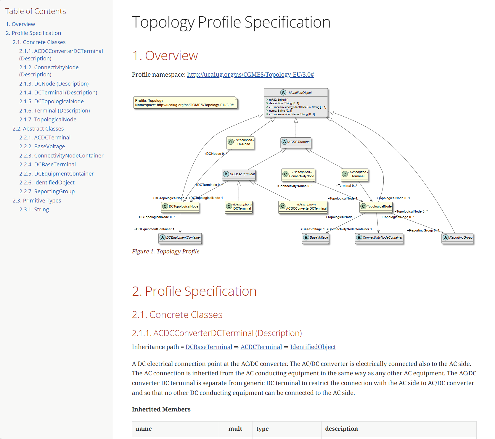
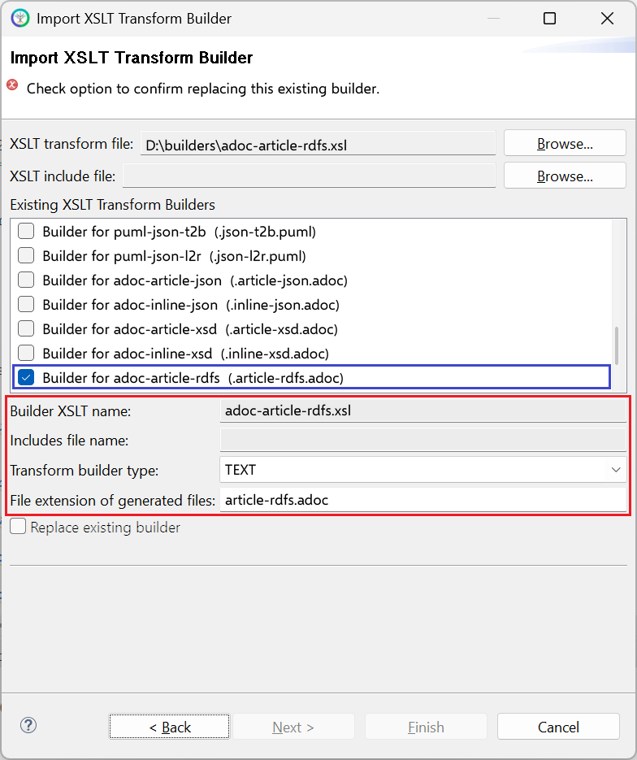

# adoc-article-rdfs.xsl

This builder currently ships with CIMTool.

## Builder Description

The **[adoc-article-rdfs.xsl](adoc-article-rdfs.xsl)** builder generates documentation for an RDFS profile in [AsciiDoc](https://asciidoc.org/) format as a standalone article. The article has a title, a table of contents, the profile's class diagram and a section for each class, compound, enumeration and datatype, with tables of native and inherited members and cross-reference links between them. Text entered on the "Documentation" tab in CIMTool is included alongside the UML and profile descriptions.

The diagram is included from the ```<profile>.rdfs-t2b.puml``` file generated by the [puml-rdfs-t2b.xsl](../puml-rdfs-t2b/builder.md) builder, so that builder should also be enabled for the profile. For content to embed within a larger AsciiDoc document use the [adoc-inline-rdfs.xsl](../adoc-inline-rdfs/builder.md) builder. A variant with an additional mapping column is provided by the [adoc-article-rdfs-mappings.xsl](../adoc-article-rdfs-mappings/builder.md) builder. Equivalent builders are provided for XSD ([adoc-article-xsd.xsl](../adoc-article-xsd/builder.md), [adoc-inline-xsd.xsl](../adoc-inline-xsd/builder.md)) and JSON schema ([adoc-article-json.xsl](../adoc-article-json/builder.md), [adoc-inline-json.xsl](../adoc-inline-json/builder.md)) profiles.

The following shows the article generated from a CGMES Topology profile, rendered to HTML:



Below is an extract of the AsciiDoc source generated from a EuropeanExtensions profile:

```asciidoc
:doctype: article
:reproducible:
:icons: font
:sectnums:
:sectnumlevels: 4
:xrefstyle: short
:table-stripes: even
...
= EuropeanExtensions Profile Specification
...
:toc-placement: preamble
:toc-title: Table of Contents
:toc:
:toclevels: 6

== Overview
...
=== Concrete Classes

[[EuropeanExtensions-BoundaryPoint]]
==== BoundaryPoint (European)
...
*Native Members*

[%header,width="100%",cols="25%,^10%,20%,45%a"]
|===
|name |mult |type |description
|[.extension-prefix]##eu:​##[.extension.European]##fromEndIsoCode##
|0..1
|<<EuropeanExtensions-String,String>>
|
The ISO code of the region which the "From" side of the Boundary point belongs to or it is connected to.
...
|===
```

## XSLT Version

This builder is XSLT 3.0 compliant.

## Release History

| CIMTool Release | Release Date | Changes |
|---|---|---|
| [2.3.0](https://cimtool.ucaiug.io/release-notes/) | 08-Jun-2026 | Added to CIMTool ([#24](https://github.com/cimug-org/CIMTool/issues/24)). |

## Author

Todd Viegut [@tviegut] on behalf of UCAIug.

## Submission Date

04-Nov-2024

## Builder NTE Configuration

Given this builder ships with CIMTool the below screenshot highlights the existing NTE (Name/Type/Extension) settings for the builder.  We strongly recommend that you do not import customized versions of this shipped builder over the original in your local CIMTool installation. Doing so will force regeneration of any existing builder-generated artifacts for projects in your workspace that have this builder enabled.

The recommended best practice is to rename the builder file  (from ```adoc-article-rdfs.xsl``` to ```custom-adoc-article-rdfs.xsl``` for example) before importing. On import this will be interpreted as a new builder and you will be allowed to enter values in the Type and Extension fields.

>*NOTE: </br>CIMTool requires that file extensions be unique and will prevent you from entering an extension already assigned to a builder. This is because an artifact's name is derived by concatenating the base name of the CIMTool ```.owl``` profile with the file extension assigned to the builder. Therefore, a unique file extension must be assigned to each builder when imported. The file extension for a builder can be modified later from within the "Maintain XSLT Transform Builders" screen.*



## License

This builder is released under the [Apache 2.0](../../LICENSE) license and was developed under sponsorship of the UCAIug.
