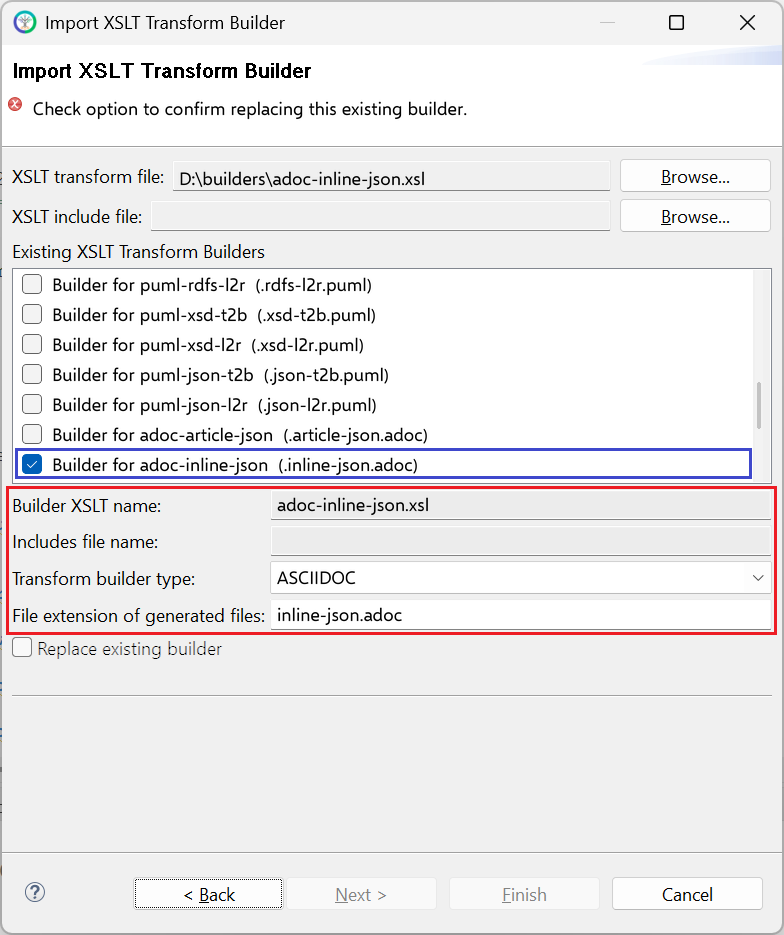

# adoc-inline-json.xsl

This builder currently ships with CIMTool.

## Builder Description

The **[adoc-inline-json.xsl](adoc-inline-json.xsl)** builder generates documentation for a JSON schema profile in [AsciiDoc](https://asciidoc.org/) format as content to be included within a larger AsciiDoc document. The output has no document header, title or table of contents. It starts with a section for the profile and otherwise matches the [adoc-article-json.xsl](../adoc-article-json/builder.md) builder: the profile's class diagram and a section for each class, compound, enumeration and datatype, with tables of native and inherited members. Text entered on the "Documentation" tab in CIMTool is included alongside the UML and profile descriptions.

The diagram is included from the ```<profile>.json-l2r.puml``` file generated by the [puml-json-l2r.xsl](../puml-json-l2r/builder.md) builder, so that builder should also be enabled for the profile. As of CIMTool 2.3.1 the diagram is referenced through the ```{profilesdir}``` attribute, which defaults to the ```Profiles``` folder beside the document; a document that includes this output from another folder can set ```profilesdir``` to the folder holding the diagrams. For a standalone document use the [adoc-article-json.xsl](../adoc-article-json/builder.md) builder. Equivalent builders are provided for RDFS ([adoc-article-rdfs.xsl](../adoc-article-rdfs/builder.md), [adoc-inline-rdfs.xsl](../adoc-inline-rdfs/builder.md)) and XSD ([adoc-article-xsd.xsl](../adoc-article-xsd/builder.md), [adoc-inline-xsd.xsl](../adoc-inline-xsd/builder.md)) profiles.

Below is an extract generated from the GetUsagePointGroups profile in the [CIMTool-Test-Project](../../builder-submissions/CIMTool-Test-Project/Profiles/GetUsagePointGroups.xml):

```asciidoc
== GetUsagePointGroups Profile Specification

// Settings:
:doctype: inline
:reproducible:
:icons: font
:sectnums:
:sectnumlevels: 4
:xrefstyle: short
ifndef::profilesdir[:profilesdir: {docdir}/Profiles]

Profile namespace: http://ucaiug.org/2022/GetUsagePointGroups#

.GetUsagePointGroups Profile
plantuml::{profilesdir}/GetUsagePointGroups.json-l2r.puml[format=svg, align=center]
...
[[GetUsagePointGroups-DemandResponseProgram]]
==== DemandResponseProgram

:DemandResponseProgram:

Demand response program.

*Native Members*

[%header,width="100%",cols="25%,^10%,20%a,45%a"]
|===
|name |mult |type |description
|mRID
|0..1
|<<GetUsagePointGroups-String,String>>
|
Master resource identifier issued by a model authority. The mRID is unique within an exchange context. Global uniqueness is easily achieved by using a UUID, as specified in RFC 4122, for the mRID. The use of UUID is strongly recommended.

For CIMXML data files in RDF syntax conforming to IEC 61970-552, the mRID is mapped to rdf:ID or rdf:about attributes that identify CIM object elements.

...
|===
```

## XSLT Version

This builder is XSLT 3.0 compliant.

## Release History

| CIMTool Release | Release Date | Changes |
|---|---|---|
| [2.3.1](https://cimtool.ucaiug.io/release-notes/) | 09-Nov-2026 | Registered as the new ```ASCIIDOC``` builder type, so whitespace authored on the "Documentation" tab is kept in the generated file ([#288](https://github.com/cimug-org/CIMTool/issues/288)). Diagrams are now included through the ```{profilesdir}``` attribute ([#291](https://github.com/cimug-org/CIMTool/issues/291)), and CIMTool's internal stereotypes are left out of attribute and association names ([#335](https://github.com/cimug-org/CIMTool/issues/335)). |
| [2.3.0](https://cimtool.ucaiug.io/release-notes/) | 08-Jun-2026 | Added to CIMTool ([#24](https://github.com/cimug-org/CIMTool/issues/24)). |

## Author

Todd Viegut [@tviegut] on behalf of UCAIug.

## Submission Date

01-Jan-2026

## Builder NTE Configuration

Given this builder ships with CIMTool the below screenshot highlights the existing NTE (Name/Type/Extension) settings for the builder.  We strongly recommend that you do not import customized versions of this shipped builder over the original in your local CIMTool installation. Doing so will force regeneration of any existing builder-generated artifacts for projects in your workspace that have this builder enabled.

The recommended best practice is to rename the builder file  (from ```adoc-inline-json.xsl``` to ```custom-adoc-inline-json.xsl``` for example) before importing. On import this will be interpreted as a new builder and you will be allowed to enter values in the Type and Extension fields.

>*NOTE: </br>CIMTool requires that file extensions be unique and will prevent you from entering an extension already assigned to a builder. This is because an artifact's name is derived by concatenating the base name of the CIMTool ```.owl``` profile with the file extension assigned to the builder. Therefore, a unique file extension must be assigned to each builder when imported. The file extension for a builder can be modified later from within the "Maintain XSLT Transform Builders" screen.*



## License

This builder is released under the [Apache 2.0](../../LICENSE) license and was developed under sponsorship of the UCAIug.
