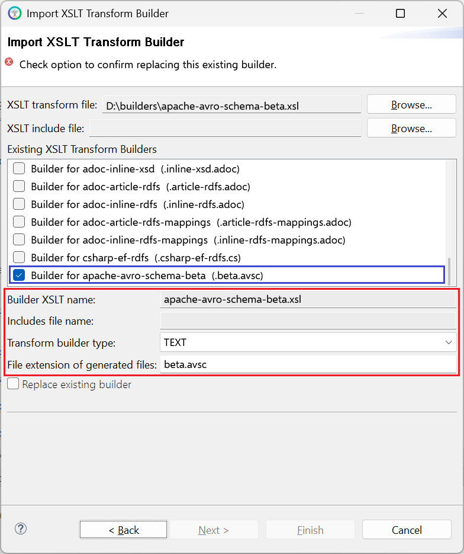

# apache-avro-schema-beta.xsl

This builder currently ships with CIMTool.

>*NOTE: </br>This builder is a beta. Its output may change in later releases of CIMTool.*

## Builder Description

The **[apache-avro-schema-beta.xsl](apache-avro-schema-beta.xsl)** builder generates an [Apache Avro](https://avro.apache.org/) schema (```.avsc```) for the profile that this builder is executed for. The output is a JSON array of Avro schemas: a header record, an ```enum``` for each enumeration, a ```record``` for each compound and concrete class, and a top-level ```record``` named after the profile. Schema namespaces are derived from the profile's base URI, and each record, enum and field carries the UML description and the CIM URI of the class or property it represents.

The examples below are taken from the [Avro4CIM case study](https://github.com/cimug-org/Avro4CIM/blob/main/case-study/README.md), which uses this builder to generate an Avro schema for the CSA 2.4 Security Analysis Result (SAR) profile. The profile is shown below:

![CSA 2.4 Security Analysis Result profile](https://img.plantuml.biz/plantuml/svg/hLVRJkD847ttLxJ8mqYB4W84jA08ZUF4cf56B4eG-x3QXyQk92tQRgkx3PCT-FUjQZl1bpWxZDOMYbrrwjIrA-6piLpRF96ULHcpYZqgQrN2Og4XiaAbdlU9gOoUs4hpM41gsIEFdbPQvMbC5aOakUGMsCndfvU3xsZB4PeOppo9DEFuo2OxYq19fLaldD3TxqqlfsV1Z9ny4J6mI79Zc8XKQhor4mWTIIYU8SdiXYLWroesP7A_5eQHoZ2x1iQjrU8nnqWAWdVtZjRVgh-YTY7-0JQiG7ojrKiPtEXYT3cwg2ZDciVgHQGhPdKEv9fqAGcMQ90g2rLtzCv-U8nzQkMz7DADghOcMluEvwHHEWPT3uMnKAMsb9sxgvJTyWGmUC5bAN2PdPxjYB18qLCAMDPJb2tgcRnvpIgvkDljceL1UFNQ2wzcqndnx8fPYUl27mr7GJtMeRkseTcD19mm6LCa5ZGekybW7_mBS8pziAP6jxzg-qf0VIdhCFjk8JKqsovtd2FZE6DOYbIuyMyLOpnksDxSiDuifFkr9yLgRN7uDri__gEncaVsGmvuQKJCeRjAvWr8gLwstBCqJq1pOlavNdWtS45VXU7iuhKt7OP-SEaLd7WCjFbGj40cPQZd8VA5OJ0C9jKv68zdMz2kZ-q9QgFUwAYviryhYjcDZbSgjp5KDDw-0_cJKpAug1scKVc6G3ThxR5ympZzE6QyS6NL2zTniPNoB0FD92nn1fHEyLajdQ9Savwpu8Oj8Cgri1i_vN9ZX9c3oQMz9MsZ--nEgwMGSDrXGn3Q2oRZ4OBMrcRc-kI4P_rd5GqYaOm6a9_ijpqv6unw7k1gfxYe_dum3Uv19m9n7g_DSqt7watwGTr3ymat4E3VdNh1Oui957wOIDU0xWrRQlo-QMYzWhxBTZo-3T15uQEbVEttkomfe02xXmiGqcZJJAUYwiYcWlYLX0wO_tTEtSRU0TwZumFAuM3msn7hzs_gC7PwLAl5THaTLU2Fh5mXN7uJYR3D6ZRr7OLiPj1WwQXEWmhd_BZKe5n9t2OFNEQ00QCjj-mlJF3qxnhEtek405FyoKAFLQKm3q995pqY9af9u6aLy5oot-4IeLz2RNw7y14Iv5eZX7BeXAKhIMpkSmeh3RXoEx0FY7jGql8LT4B8hP_XoaE_he3To3b2vu1r5Czm4FedSRPXUsRqwFZGTDKs1OvNRQjyZAerOHJIKNlmTbFRfdU0zrvNsUUGAMqXdcpci2gLo5w-L4z28MfERWdSFx35xCyX0Tp-qYz-ORS8gjeF467hfO3OsqTJwYfRfjBePFvrYfajy0ivNH7rVbkgpJvvjNhDKcFbcg9T2N_TIwD4hZqroV_WOq57BLIwZbn4QtmlPy91QYFX9Cs65h3EFdx6Brlw1ypx5m00)

In the generated schema, the ```RemedialActionApplied``` class becomes a ```record```. Its ```PowerFlowResult``` association refers to the abstract ```PowerFlowResult``` class, so the field is a union of the records for its concrete subclasses. Associations to classes that have no fields in the profile, such as ```RemedialAction```, are ```string``` fields holding the identifier of the referenced object, and optional fields are unions with ```"null"```:

```json
{
     "type": "record",
     "name": "RemedialActionApplied",
     "namespace": "eu.cim4.ap_voc.securityanalysisresult.extsecurityanalysisresult",
     "doc": "Remedial Action or Remedial Action Stage that has been applied to the power flow case which has the associated power flow result.",
     "modelReference": "https://cim4.eu/ns/nc#RemedialActionApplied",
     "fields": [
          {
               "name": "mRID",
               "type": "string",
               "doc": "Master resource identifier issued by a model authority. The mRID is unique within an exchange context. Global uniqueness is easily achieved by using a UUID, as specified in RFC 4122, for the mRID. The use of UUID is strongly recommended.For CIMXML data files in RDF syntax conforming to IEC 61970-552, the mRID is mapped to rdf:ID or rdf:about attributes that identify CIM object elements.",
               "modelReference": "https://cim4.eu/ns/nc#RemedialActionApplied.mRID"
          },
          {
               "name": "PowerFlowResult",
               "type": [
                    "eu.cim4.ap_voc.securityanalysisresult.extsecurityanalysisresult.BaseCasePowerFlowResult",
                    "eu.cim4.ap_voc.securityanalysisresult.extsecurityanalysisresult.ContingencyPowerFlowResult"
               ],
               "doc": "Power flow result that is obtained when the remedial action is applied.",
               "modelReference": "https://cim4.eu/ns/nc#RemedialActionApplied.PowerFlowResult"
          },
          {
               "name": "RemedialAction",
               "type": "string",
               "doc": "Remedial action that is applied. Note that the value of this field is the identifier (e.g. mRID) used to reference the RemedialAction external to this profile.",
               "modelReference": "https://cim4.eu/ns/nc#RemedialActionApplied.RemedialAction"
          },
          {
               "name": "StageForRemedialActionScheme",
               "type": [ "null", "string" ],
               "default": null,
               "doc": "The stage of the remedial action scheme that is applied. Note that the value of this field is the identifier (e.g. mRID) used to reference the Stage external to this profile.",
               "modelReference": "https://cim4.eu/ns/nc#RemedialActionApplied.StageForRemedialActionScheme"
          }
     ]
}
```

The schema ends with a record named after the profile, which carries the ```header``` and one array for each class that no other class references:

```json
{
     "copyright": "Copyright 2025 UCAIug SPDX-License-Identifier: Apache-2.0",
     "generator": "Generated by CIMTool https://cimtool.ucaiug.io",
     "profile-metadata": {
         "metaDoc": "Abstract profile this schema implements (DX-PROF prof:Profile):",
         "profProfile": "https://ap-voc.cim4.eu/SecurityAnalysisResult/2.4#",
         "metaDoc": "Underlying standards the profile/schema conforms to (IEC etc.):",
         "metaDoc": "Currently hardcoded until consensus is reached on how/where this will be specified/sourced from in tooling:",
         "dctConformsTo": [
              "urn:iso:std:iec:61970-301:ed-7:amd1",
              "urn:iso:std:iec:61970-600-2:ed-1"
         ],
         "metaDoc": "Where this schema was generated from (OWL/RDFS/SHACL/LinkML, etc.):",
         "dctSource": [
              "https://ap-voc.cim4.eu/SecurityAnalysisResult/2.4/owl"
         ],
         "metaDoc": "Identity + version of this Avro schema itself:",
         "metaDoc": "Currently hardcoded until consensus is reached on how/where this will be specified/sourced from in tooling:",
         "schemaId": "https://schema-registry.example.com/subjects/cim-sv-dataset-value/versions/5",
         "metaDoc": "Currently hardcoded to 1.0.0 until consensus is reached on how/where this will be specified/sourced from in tooling:",
         "schemaVersion": "1.0.0"
     },
     "type": "record",
     "name": "SecurityAnalysisResult",
     "namespace": "eu.cim4.ap_voc.securityanalysisresult",
     "doc": "The Security Analysis Result (SAR) profile is a profile to exchange a security analysis result.The security analysis result includes each limit violation detected for each assessed element and for a given contingency. The limit violation has a direct association to operational limit and contingency. The association to the operational limit provides information on the following:- The terminal (the end of the equipment) where the limit is defined- The equipment to which the limit is related- The type of the limit e.g. PATL, TATL, etc including the relevant time phase and other conditionsThe association to the contingency provides information which contingency was simulated when this limit violation was detected.This profile is not intended to replace the Topology (TP) and State Variables (SV) profiles. Its intention is to exchange a power flow result that is relevant for security optimization, either through violation or through a loading threshold. Systems should not use this profile for dumping a full database. The modeling is optimized to have the minimum size in addition to a well defined value definition (e.g. active power, apparent power, etc.).Recommendation: If the terminals are connected with zero impedance, it is recommended to include only one terminal with a voltage (e.g. the terminal of a BusbarSection). The connection between Contingency and Remedial Action is given by the Remedial Action Profile. The connection between AssessedElement and PowerFlowResult is given by the OperationalLimit.",
     "fields": [
          {
               "name": "header",
               "type": "eu.cim4.ap_voc.securityanalysisresult.Header",
               "doc": "The standardized messaging header that must be included with each message compliant with this profile."
          },
          {
               "name": "RemedialActionApplied",
               "type": {
                   "type": "array",
                   "items": "eu.cim4.ap_voc.securityanalysisresult.extsecurityanalysisresult.RemedialActionApplied"
               },
               "doc": "Remedial Action or Remedial Action Stage that has been applied to the power flow case which has the associated power flow result.",
               "minCardDoc": "[min cardinality = 1] Application level validation will be required to ensure the array contains at least 1 item."
          }
     ]
}
```

A message that conforms to the schema, from the case study's example payloads:

```json
{
  "header": {
    "profProfile": "https://ap-voc.cim4.eu/SecurityAnalysisResult/2.4",
    "identifier": "sar-single-action-base-002",
    "isVersionOf": "urn:uuid:base-case-2024-01-01",
    "version": "1.0",
    "startDate": "2024-01-01T00:00:00Z",
    "schemaRef": "https://schemas.cim4.eu/avro/SecurityAnalysisResult/2.4.0"
  },
  "RemedialActionApplied": [
    {
      "mRID": "550e8400-e29b-41d4-a716-446655440000",
      "PowerFlowResult": {
        "eu.cim4.ap_voc.securityanalysisresult.extsecurityanalysisresult.BaseCasePowerFlowResult": {
          "absoluteValue": 850.0,
          "atTime": 1704067200000,
          "isViolation": false,
          "value": 85.0,
          "valueA": 850.0,
          "valueAngle": null,
          "valueV": null,
          "valueVA": null,
          "valueVAR": null,
          "valueW": null,
          "ACDCTerminal": "f47ac10b-58cc-4372-a567-0e02b2c3d479",
          "OperationalLimit": "6ba7b810-9dad-11d1-80b4-00c04fd430c8",
          "ReportedByRegion": "10Y-DE-ENTSOE-1"
        }
      },
      "RemedialAction": "a1b2c3d4-e5f6-4a7b-8c9d-0e1f2a3b4c5d",
      "StageForRemedialActionScheme": null
    }
  ]
}
```

The complete schemas, further example payloads and a detailed description of the mapping from CIM to Avro are in the [case study](https://github.com/cimug-org/Avro4CIM/blob/main/case-study/README.md).

## XSLT Version

This builder is XSLT 2.0 compliant.

## Release History

| CIMTool Release | Release Date | Changes |
|---|---|---|
| [2.3.0](https://cimtool.ucaiug.io/release-notes/) | 08-Jun-2026 | Added to CIMTool as a beta. |

## Author

Todd Viegut [@tviegut] on behalf of UCAIug.

## Submission Date

01-Dec-2025

## Builder NTE Configuration

Given this builder ships with CIMTool the below screenshot highlights the existing NTE (Name/Type/Extension) settings for the builder.  We strongly recommend that you do not import customized versions of this shipped builder over the original in your local CIMTool installation. Doing so will force regeneration of any existing builder-generated artifacts for projects in your workspace that have this builder enabled.

The recommended best practice is to rename the builder file  (from ```apache-avro-schema-beta.xsl``` to ```custom-apache-avro-schema-beta.xsl``` for example) before importing. On import this will be interpreted as a new builder and you will be allowed to enter values in the Type and Extension fields.

>*NOTE: </br>CIMTool requires that file extensions be unique and will prevent you from entering an extension already assigned to a builder. This is because an artifact's name is derived by concatenating the base name of the CIMTool ```.owl``` profile with the file extension assigned to the builder. Therefore, a unique file extension must be assigned to each builder when imported. The file extension for a builder can be modified later from within the "Maintain XSLT Transform Builders" screen.*



## License

This builder is released under the [Apache 2.0](../../LICENSE) license and was developed under sponsorship of the UCAIug.
