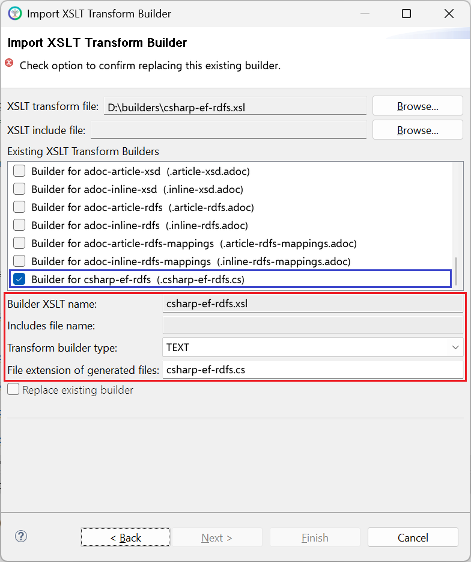

# csharp-ef-rdfs.xsl

This builder currently ships with CIMTool.

## Builder Description

The **[csharp-ef-rdfs.xsl](csharp-ef-rdfs.xsl)** builder generates a C# source file containing [Entity Framework Core](https://learn.microsoft.com/en-us/ef/core/) entity classes for RDFS profiles such as CGMES, together with [Fluent API](https://learn.microsoft.com/en-us/ef/core/modeling/) configuration and a base ```DbContext```. The classes map to the database schema generated by the [sql-rdfs-ansi92.xsl](../sql-rdfs-ansi92/builder.md) builder, using the same key rules: an ```MRId``` key for classes in the IdentifiedObject hierarchy and a surrogate ```Id``` key for other classes and for ```<<Compound>>``` types. Date and time types map to ```DateOnly``` and ```TimeOnly```, which require .NET 6 or later.

Refer to the comments in the generated C# source file for details of the design and its motivations. The [jpa-rdfs.xsl](../jpa-rdfs/builder.md) builder is the equivalent for Java.

Below is an extract generated from a CGMES CoreEquipment profile, showing the ```CurveData``` class, its Fluent API configuration and its ```DbSet```:

```csharp
    /// <summary>
    /// Multi-purpose data points for defining a curve. The use of this generic
    /// class is discouraged if a more specific class can be used to specify the
    /// X and Y axis values along with their specific data types.
    /// </summary>
    [Table("CurveData")]
    [Index(nameof(Xvalue), nameof(Y1value), nameof(CurveId), IsUnique = true)]
    public class CurveData
    {
        public CurveData() { }
        public override string ToString() { return this.GetType().Name; }
        ...
        [Key]
        [Column("id")]
        [MaxLength(100)]
        public string Id { get; set; } = null!;
        ...
        /// <summary>
        /// The curve of this curve data point.
        /// </summary>
        [Column("Curve")]
        [MaxLength(100)]
        public string CurveId { get; set; } = null!;

        [ForeignKey(nameof(CurveId))]
        public virtual Curve? Curve { get; set; }
    }
    ...
        private static void ConfigureCurveData(ModelBuilder modelBuilder)
        {
            var e = modelBuilder.Entity<CurveData>();
            e.ToTable("CurveData");
            e.HasOne(x => x.Curve).WithMany().HasForeignKey(x => x.CurveId).OnDelete(DeleteBehavior.ClientNoAction);
        }
        ...
        public DbSet<CoreEquipment.CurveData> CurveDatas => Set<CoreEquipment.CurveData>();
        ...
```

This builder was developed from the community ```csharp-entity-framework.xsl``` builder contributed to this library by Yunshu Wang, which it replaces.

## XSLT Version

This builder is XSLT 3.0 compliant.

## Release History

| CIMTool Release | Release Date | Changes |
|---|---|---|
| [2.3.0](https://cimtool.ucaiug.io/release-notes/) | 08-Jun-2026 | Added to CIMTool, developed from the community ```csharp-entity-framework.xsl``` builder ([#202](https://github.com/cimug-org/CIMTool/issues/202)). |

## Author

Todd Viegut [@tviegut] on behalf of UCAIug, based on the original csharp-entity-framework.xsl by Yunshu Wang.

## Submission Date

01-Apr-2026

## Builder NTE Configuration

Given this builder ships with CIMTool the below screenshot highlights the existing NTE (Name/Type/Extension) settings for the builder.  We strongly recommend that you do not import customized versions of this shipped builder over the original in your local CIMTool installation. Doing so will force regeneration of any existing builder-generated artifacts for projects in your workspace that have this builder enabled.

The recommended best practice is to rename the builder file  (from ```csharp-ef-rdfs.xsl``` to ```custom-csharp-ef-rdfs.xsl``` for example) before importing. On import this will be interpreted as a new builder and you will be allowed to enter values in the Type and Extension fields.

>*NOTE: </br>CIMTool requires that file extensions be unique and will prevent you from entering an extension already assigned to a builder. This is because an artifact's name is derived by concatenating the base name of the CIMTool ```.owl``` profile with the file extension assigned to the builder. Therefore, a unique file extension must be assigned to each builder when imported. The file extension for a builder can be modified later from within the "Maintain XSLT Transform Builders" screen.*



## License

This builder is released under the [Apache 2.0](../../LICENSE) license and was developed under sponsorship of the UCAIug.
