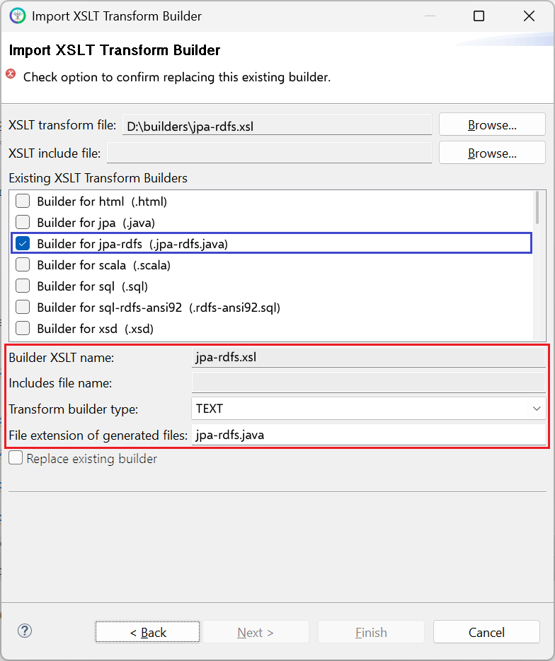

# jpa-rdfs.xsl

This builder currently ships with CIMTool.

## Builder Description

The **[jpa-rdfs.xsl](jpa-rdfs.xsl)** builder generates a [Java](https://www.java.com/en/download/help/whatis_java.html) source file containing JPA entity classes compatible with [Jakarta Persistence 3.1](https://jakarta.ee/specifications/persistence/3.1/) (Jakarta EE 10), for RDFS profiles such as CGMES. The classes map to the database schema generated by the [sql-rdfs-ansi92.xsl](../sql-rdfs-ansi92/builder.md) builder. Classes in the IdentifiedObject hierarchy use an ```mRID``` key, while classes outside it (for example ```CurveData```) and ```<<Compound>>``` types use a UUID key generated by the JPA provider. The [jpa.xsl](../jpa/builder.md) builder is the equivalent for the [sql.xsl](../sql/builder.md) schema.

Refer to the comments at the top of the generated Java source file for details of the design and its motivations, including example ```persistence.xml``` settings for common JPA providers.

Below is an extract generated from a ComModuleConfig profile, showing the ```Status``` compound class and the reference to it from ```ActivityRecord```:

```java
    /**
     * Current status information relevant to an entity.
     */
    @Entity
    @Table(name="Status")
    public static class Status {

        @Id
        @GeneratedValue(strategy=GenerationType.UUID)
        @Column(name="id")
        private UUID id;

        public UUID getId() {
            return id;
        }
        public void setId(UUID id) {
            this.id = id;
        }

        @Override
        public boolean equals(Object o) {
            if (this == o) return true;
            if (o == null || getClass() != o.getClass()) return false;
            Status that = (Status) o;
            return id != null && id.equals(that.id);
        }

        @Override
        public int hashCode() {
            return getClass().hashCode();
        }
        ...
    }
    ...
    public static class ActivityRecord {
        ...
        /**
         * Information on consequence of event resulting in this activity record.
         */
        @ManyToOne(fetch=FetchType.LAZY, cascade=CascadeType.REMOVE)
        @JoinColumn(name="status")
        private Status status;
        ...
```

## XSLT Version

This builder is XSLT 3.0 compliant.

## Release History

| CIMTool Release | Release Date | Changes |
|---|---|---|
| [2.3.0](https://cimtool.ucaiug.io/release-notes/) | 08-Jun-2026 | Added to CIMTool ([#224](https://github.com/cimug-org/CIMTool/issues/224)). |

## Author

Todd Viegut [@tviegut] on behalf of UCAIug.

## Submission Date

01-Apr-2026

## Builder NTE Configuration

Given this builder ships with CIMTool the below screenshot highlights the existing NTE (Name/Type/Extension) settings for the builder.  We strongly recommend that you do not import customized versions of this shipped builder over the original in your local CIMTool installation. Doing so will force regeneration of any existing builder-generated artifacts for projects in your workspace that have this builder enabled.

The recommended best practice is to rename the builder file  (from ```jpa-rdfs.xsl``` to ```custom-jpa-rdfs.xsl``` for example) before importing. On import this will be interpreted as a new builder and you will be allowed to enter values in the Type and Extension fields.

>*NOTE: </br>CIMTool requires that file extensions be unique and will prevent you from entering an extension already assigned to a builder. This is because an artifact's name is derived by concatenating the base name of the CIMTool ```.owl``` profile with the file extension assigned to the builder. Therefore, a unique file extension must be assigned to each builder when imported. The file extension for a builder can be modified later from within the "Maintain XSLT Transform Builders" screen.*



## License

This builder is released under the [Apache 2.0](../../LICENSE) license and was developed under sponsorship of the UCAIug.
