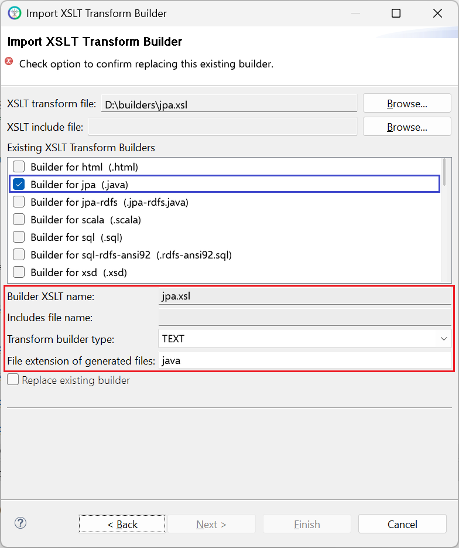

# jpa.xsl

This builder currently ships with CIMTool.

## Builder Description

The **[jpa.xsl](jpa.xsl)** builder generates a [Java](https://www.java.com/en/download/help/whatis_java.html) source file containing JPA entity classes. As of CIMTool 2.3.0 the builder supports [Jakarta Persistence 3.1](https://jakarta.ee/specifications/persistence/3.1/) (Jakarta EE 10).

What is JPA? The [Jakarta Persistence API](https://jcp.org/en/jsr/detail?id=338) (formerly Java Persistence API) is a Java specification that is concerned with persistence whereby, an application's key business objects are stored beyond the life of the process that created them. The JPA specification lets you define which objects should be persisted, and how they are persisted in Java applications. It was first released as a subset of the Enterprise JavaBeans 3.0 specification ([JSR 220](https://jcp.org/en/jsr/detail?id=220)) in Java EE 5. It has since evolved as its own specification starting with the release of JPA 2.0 in Java EE 6 ([JSR 317](https://jcp.org/en/jsr/detail?id=317)). JPA was adopted as an independent project of Jakarta EE in 2019. The current release is [JPA 3.1](https://projects.eclipse.org/projects/ee4j.jpa).

Popular JPA implementations include [Hibernate](https://hibernate.org/) and [EclipseLink](https://www.eclipse.org/eclipselink/).

Next is a sample extract of a Java source file containing JPA classes, generated from a ComModuleConfig profile:

```java
package io.ucaiug.cimtool.generated;
import jakarta.persistence.*;
import java.time.*;
/**
 * Annotated java for the ComModuleConfig profile.
 * Generated by CIMTool https://cimtool.ucaiug.io
 */
public class ComModuleConfig
{
    /**
     * Records activity for an entity at a point in time; activity may be for
     * an event that has already occurred or for a planned activity.
     */
    @Entity
    @Table(name="ActivityRecord")
    @Inheritance(strategy=InheritanceType.JOINED)
    public static class ActivityRecord
    {
        public String getMRID () { return mRID; }
        public void setMRID ( String mRID ) { this.mRID = mRID; }
        @Id
        @Column(name="mRID")
        private String mRID ;

        /**
         * Date and time this activity record has been created (different from the
         * 'status.dateTime', which is the time of a status change of the associated
         * object, if applicable).
         */
        public LocalDateTime getCreatedDateTime () { return createdDateTime; }
        public void setCreatedDateTime ( LocalDateTime createdDateTime ) { this.createdDateTime = createdDateTime; }
        @Basic(optional=true)
        @Column(name="createdDateTime")
        private LocalDateTime createdDateTime ;

        /**
         * Reason for event resulting in this activity record, typically supplied
         * when user initiated.
         */
        public String getReason () { return reason; }
        public void setReason ( String reason ) { this.reason = reason; }
        @Basic(optional=true)
        @Column(name="reason")
        private String reason ;

        /**
         * Severity level of event resulting in this activity record.
         */
        public String getSeverity () { return severity; }
        public void setSeverity ( String severity ) { this.severity = severity; }
        @Basic(optional=true)
        @Column(name="severity")
        private String severity ;

        /**
         * Information on consequence of event resulting in this activity record.
         */
        public Status getStatus () { return status; }
        public void setStatus ( Status status ) { this.status = status; }
        @ManyToOne(fetch=FetchType.LAZY, optional=true)
        @JoinColumn(name="status")
        private Status status ;

        /**
         * Type of event resulting in this activity record.
         */
        public String getType () { return type; }
        public void setType ( String type ) { this.type = type; }
        @Basic(optional=true)
        @Column(name="type")
        private String type ;

    }

    /**
     * Usage for an asset model.
     */
    @Entity
    @Table(name="AssetModelUsageKind")
    public static class AssetModelUsageKind
    {
        public String getName () { return name; }
        public void setName ( String name ) { this.name = name; }
        @Id
        @Column(name="name")
        private String name ;

    };

    /**
     * Kind of communication direction.
     */
    @Entity
    @Table(name="ComDirectionKind")
    public static class ComDirectionKind
    {
        public String getName () { return name; }
        public void setName ( String name ) { this.name = name; }
        @Id
        @Column(name="name")
        private String name ;

    ...
    public static final Class[] allClasses = new Class[]
    {
        ActivityRecord.class,
        AssetModelUsageKind.class,
        ComDirectionKind.class,
        ComFunction.class,
        ComModule.class,
        ComTechnologyKind.class,
        ConfigurationEvent.class,
        CorporateStandardKind.class,
        EndDeviceInfo.class,
        Manufacturer.class,
        Name.class,
        NameType.class,
        NameTypeAuthority.class,
        ProductAssetModel.class
    };
}
```
For RDFS profiles (such as CGMES), the [jpa-rdfs.xsl](../jpa-rdfs/builder.md) builder generates entity classes that match the [sql-rdfs-ansi92.xsl](../sql-rdfs-ansi92/builder.md) database schema.

## XSLT Version

This builder is XSLT 1.0 compliant.

## Release History

| CIMTool Release | Release Date | Changes |
|---|---|---|
| [2.3.0](https://cimtool.ucaiug.io/release-notes/) | 08-Jun-2026 | Upgraded to Jakarta Persistence 3.1 (Jakarta EE 10), with date and time types mapped to ```java.time``` classes. Compound types are now generated as entities, and the default package is now ```io.ucaiug.cimtool.generated``` ([#224](https://github.com/cimug-org/CIMTool/issues/224)). |
| [2.1.0](https://cimtool.ucaiug.io/release-notes/) | 09-Aug-2024 | Updated the CIMTool web address in the generated header. |
| [1.10.0](https://cimtool.ucaiug.io/release-notes/) | 26-Aug-2022 | Earliest release in the CIMTool GitHub repository. The builder shipped with earlier releases of CIMTool. |

## Author

Arnold deVos on behalf of UCAIug.

## Submission Date

12-May-2009

## Builder NTE Configuration

Given this builder ships with CIMTool the below screenshot highlights the existing NTE (Name/Type/Extension) settings for the builder.  We strongly recommend that you do not import customized versions of this shipped builder over the original in your local CIMTool installation. Doing so will force regeneration of any existing builder-generated artifacts for projects in your workspace that have this builder enabled.

The recommended best practice is to rename the builder file  (from ```jpa.xsl``` to ```custom-jpa.xsl``` for example) before importing. On import this will be interpreted as a new builder and you will be allowed to enter values in the Type and Extension fields.

>*NOTE: </br>CIMTool requires that file extensions be unique and will prevent you from entering an extension already assigned to a builder. This is because an artifact's name is derived by concatenating the base name of the CIMTool ```.owl``` profile with the file extension assigned to the builder. Therefore, a unique file extension must be assigned to each builder when imported. The file extension for a builder can be modified later from within the "Maintain XSLT Transform Builders" screen.*



## License

This builder is released under the [Apache 2.0](../../LICENSE) license and was developed under sponsorship of the UCAIug.
