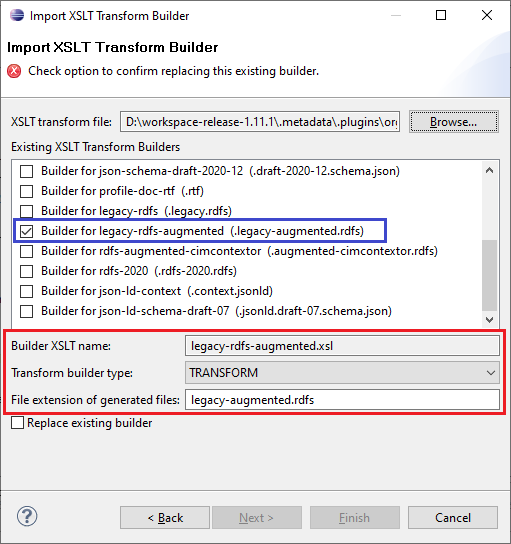

# legacy-rdfs-augmented.xsl

This builder no longer ships as an XSLT builder. CIMTool generates this format with a built-in Java builder of the same name.

## Builder Description

The **[legacy-rdfs-augmented.xsl](legacy-rdfs-augmented.xsl)** builder generates RDFS schema in primary alignment with that defined within the [IEC 61970-501:2006 "Common Information Model Resource Description Framework (CIM RDF) schema"](https://webstore.iec.ch/publication/6215) published standard. The **IEC 61970-501:2006** standard describes the format and rules for producing a machine readable form of the Common Information Model (CIM) as specified in the **IEC 61970-301** standard. It describes a CIM vocabulary to support CIM semantics. The builder has been retained for legacy and historical purposes.

Note, though not currently published as a formal standard, there has been "de facto agreements" on additional extensions to that defined in the [IEC 61970-501:2006](https://webstore.iec.ch/publication/6215) in order to better support CIM RDFS semantic needs. Introduced after the publication of the [IEC 61970-501:2006](https://webstore.iec.ch/publication/6215), the latest RDFS schema format is  commonly referred to as RDFS2020 and is in use by ENTSO-E CGMES and is supported in both **CimConteXtor/CimSyntaxGen** and **CIMTool** profiling tools. For a **CIMTool** builder that generates such RDFS2020 schemas with the latest agreed upon extensions visit the page entry for the [rdfs-2020.xsl](../rdfs-2020/builder.md) builder.

The XSLT is kept in the library for reference. For current RDFS profiles use the [rdfs-2020.xsl](../rdfs-2020/builder.md) builder.

## XSLT Version

This builder is XSLT 3.0 compliant.

## Release History

| CIMTool Release | Release Date | Changes |
|---|---|---|
| [2.3.0](https://cimtool.ucaiug.io/release-notes/) | 08-Jun-2026 | Stereotype URIs now use the ```http://iec.ch/TC57/NonStandard/UML#``` namespace instead of ```http://langdale.com.au/2005/UML#```, ```<<Compound>>``` classes and compound attributes are now generated, and associations gain ```cims:AssociationUsed```. CIMDatatype classes get the ```CIMDatatype``` stereotype and ```cims:belongsToCategory```, simple attributes take ```cims:dataType``` from their CIM datatype, and each non-shadow superclass gets its own ```rdfs:subClassOf```. |
| [2.2.0](https://cimtool.ucaiug.io/release-notes/) | 01-Oct-2024 | URIs outside the profile namespace are now written in full, multiplicities are always written as a range (for example ```M:1..1```), and ```rdfs:domain``` is taken from the property's class instead of being parsed from the property URI. Enumeration values now always carry the ```enum``` stereotype. |
| [2.0.1](https://cimtool.ucaiug.io/release-notes/) | 12-May-2024 | Changed the ```xsd``` namespace declared in the generated RDFS from ```http://www.w3.org/2001/XMLSchema#``` to ```http://www.w3.org/2001/XMLSchema```. From this release CIMTool no longer registers this XSLT builder and generates ```*.legacy-rdfs-augmented``` output with its built-in Java builder instead. |
| [1.12.0](https://cimtool.ucaiug.io/release-notes/) | 21-Feb-2024 | Added to CIMTool ([#26](https://github.com/cimug-org/CIMTool/issues/26)). It replaced the built-in Java builder for ```*.legacy-rdfs-augmented``` output. |

## Author

Todd Viegut [@tviegut] on behalf of UCAIug.

## Submission Date

21-Feb-2024

## Builder NTE Configuration

Given this builder ships with CIMTool the below screenshot highlights the existing NTE (Name/Type/Extension) settings for the builder.  We strongly recommend that you do not import customized versions of this shipped builder over the original in your local CIMTool installation. Doing so will force regeneration of any existing builder-generated artifacts for projects in your workspace that have this builder enabled.

The recommended best practice is to rename the builder file  (from ```legacy-rdfs-augmented.xsl``` to ```custom-legacy-rdfs-augmented.xsl``` for example) before importing. On import this will be interpreted as a new builder and you will be allowed to enter values in the Type and Extension fields.

>*NOTE: </br>CIMTool requires that file extensions be unique and will prevent you from entering an extension already assigned to a builder. This is because an artifact's name is derived by concatenating the base name of the CIMTool ```.owl``` profile with the file extension assigned to the builder. Therefore, a unique file extension must be assigned to each builder when imported. The file extension for a builder can be modified later from within the "Maintain XSLT Transform Builders" screen.*



## License

This builder is released under the [Apache 2.0](../../LICENSE) license and was developed under sponsorship of the UCAIug.
