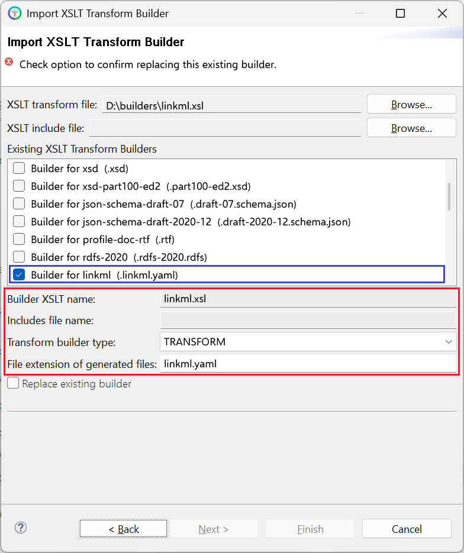

# linkml.xsl

This builder currently ships with CIMTool.

## Builder Description

The **[linkml.xsl](linkml.xsl)** builder generates a [LinkML](https://linkml.io) schema, in YAML, for the profile that this builder is executed for. The schema contains a class for each class and compound in the profile, a type for each CIMDatatype and an enum for each enumeration. The UML description of each element is output as its ```description```, and an ```ea_guid``` annotation holds the Sparx EA identifier of the UML element.

Below is an extract generated from a CGMES StateVariables profile:

```yaml
classes:
...
  SvVoltage:
    description: "State variable for voltage."
    annotations:
      ea_guid: "EAID_22A26B24_0A8E_402a_895E_AFAE18292542"
    class_uri: cim:SvVoltage
    attributes: 
      angle:
        description: "The voltage angle of the topological node complex voltage with respect to system reference."
        annotations:
          ea_guid: "EAID_1D320E89_265C_41ec_A654_A0FE668376BD"
        slot_uri: cim:SvVoltage.angle
        range: AngleDegrees
        minimum_cardinality: 1
        maximum_cardinality: 1
...
      TopologicalNode:
        description: "The topological node associated with the voltage state."
        annotations:
          ea_guid: "EAID_4628B761_2D2E_4428_AB48_91ADDAB6ED29-A"
        slot_uri: cim:SvVoltage.TopologicalNode
        range: TopologicalNode
        minimum_cardinality: 1
        maximum_cardinality: 1
...
types:
  ActivePower:
    uri: xsd:float
    base: float
    description: "Product of RMS value of the voltage and the RMS value of the in-phase component of the current."
    annotations:
      ea_guid: "EAID_E52EDC2D_8972_42c7_A7EB_D8C017E138A4"
      cim_data_type: true
      uri: cim:ActivePower
```

## XSLT Version

This builder is XSLT 3.0 compliant.

## Release History

| CIMTool Release | Release Date | Changes |
|---|---|---|
| [2.3.0](https://cimtool.ucaiug.io/release-notes/) | 08-Jun-2026 | Compound types are now generated as LinkML classes that are not marked abstract, compound attributes are generated as slots, and ```comments:``` lines are indented correctly. |
| [2.2.0](https://cimtool.ucaiug.io/release-notes/) | 01-Oct-2024 | Classes, types, slots and enumerations now carry an ```ea_guid``` annotation with the Sparx EA identifier ([#141](https://github.com/cimug-org/CIMTool/issues/141)). |
| [2.1.0](https://cimtool.ucaiug.io/release-notes/) | 09-Aug-2024 | Added to CIMTool ([#118](https://github.com/cimug-org/CIMTool/issues/118)). |

## Author

Todd Viegut [@tviegut] on behalf of UCAIug.

## Submission Date

29-Jul-2024

## Builder NTE Configuration

Given this builder ships with CIMTool the below screenshot highlights the existing NTE (Name/Type/Extension) settings for the builder.  We strongly recommend that you do not import customized versions of this shipped builder over the original in your local CIMTool installation. Doing so will force regeneration of any existing builder-generated artifacts for projects in your workspace that have this builder enabled.

The recommended best practice is to rename the builder file  (from ```linkml.xsl``` to ```custom-linkml.xsl``` for example) before importing. On import this will be interpreted as a new builder and you will be allowed to enter values in the Type and Extension fields.

>*NOTE: </br>CIMTool requires that file extensions be unique and will prevent you from entering an extension already assigned to a builder. This is because an artifact's name is derived by concatenating the base name of the CIMTool ```.owl``` profile with the file extension assigned to the builder. Therefore, a unique file extension must be assigned to each builder when imported. The file extension for a builder can be modified later from within the "Maintain XSLT Transform Builders" screen.*



## License

This builder is released under the [Apache 2.0](../../LICENSE) license and was developed under sponsorship of the UCAIug.
