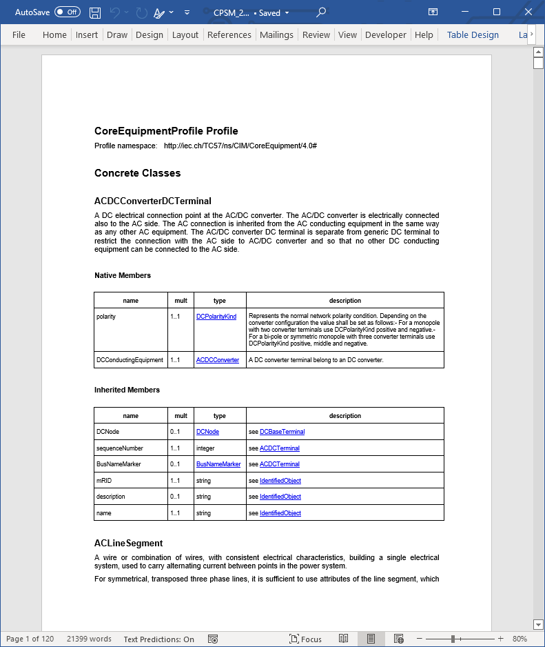
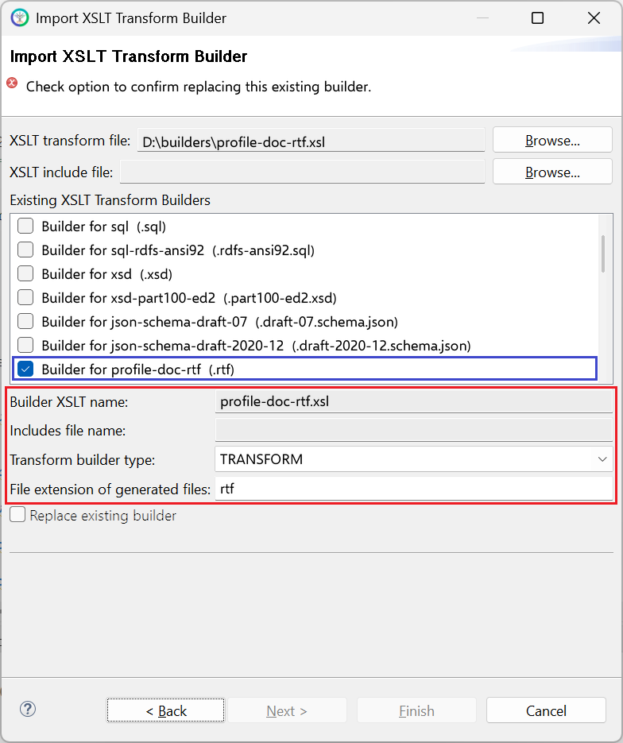

# profile-doc-rtf.xsl

This builder currently ships with CIMTool.

## Builder Description

The **[profile-doc-rtf.xsl](profile-doc-rtf.xsl)** builder produces a Microsoft Word compatible RTF ([Rich Text Format](https://en.wikipedia.org/wiki/Rich_Text_Format)) document that contains the complete documentation for all classes, attributes and associations defined in a profile.



## XSLT Version

This builder is XSLT 2.0 compliant.

## Release History

| CIMTool Release | Release Date | Changes |
|---|---|---|
| [2.3.0](https://cimtool.ucaiug.io/release-notes/) | 08-Jun-2026 | Upgraded to XSLT 2.0. Non-ASCII characters in descriptions are now written as Unicode escapes, and each comment or note is kept as its own paragraph ([#244](https://github.com/cimug-org/CIMTool/issues/244)). The document also gains a Primitive Types section, lists compound and choice members, and links attribute types to their CIM datatypes. |
| [2.0.1](https://cimtool.ucaiug.io/release-notes/) | 12-May-2024 | The Compound Types section now comes before Enumerations, the Concrete Classes section appears whenever the profile has root or message classes, and member table cells are explicitly aligned. Classes with no members that are used for 'By Reference' associations now get an explanatory note. |
| [1.12.0](https://cimtool.ucaiug.io/release-notes/) | 21-Feb-2024 | Class definitions now show a hyperlinked inheritance path, and attribute and association names are followed by their stereotypes in brackets. |
| [1.11.1](https://cimtool.ucaiug.io/release-notes/) | 14-Feb-2023 | The document title no longer repeats "Profile" when the profile name is the default ```Profile```. |
| [1.10.0](https://cimtool.ucaiug.io/release-notes/) | 26-Aug-2022 | Added to CIMTool ([#27](https://github.com/cimug-org/CIMTool/issues/27)). |

## Author

Todd Viegut [@tviegut] on behalf of UCAIug.

## Submission Date

19-Aug-2022

## Builder NTE Configuration

Given this builder ships with CIMTool the below screenshot highlights the existing NTE (Name/Type/Extension) settings for the builder.  We strongly recommend that you do not import customized versions of this shipped builder over the original in your local CIMTool installation. Doing so will force regeneration of any existing builder-generated artifacts for projects in your workspace that have this builder enabled.

The recommended best practice is to rename the builder file  (from ```profile-doc-rtf.xsl``` to ```custom-profile-doc-rtf.xsl``` for example) before importing. On import this will be interpreted as a new builder and you will be allowed to enter values in the Type and Extension fields.

>*NOTE: </br>CIMTool requires that file extensions be unique and will prevent you from entering an extension already assigned to a builder. This is because an artifact's name is derived by concatenating the base name of the CIMTool ```.owl``` profile with the file extension assigned to the builder. Therefore, a unique file extension must be assigned to each builder when imported. The file extension for a builder can be modified later from within the "Maintain XSLT Transform Builders" screen.*



## License

This builder is released under the [Apache 2.0](../../LICENSE) license and was developed under sponsorship of the UCAIug.
