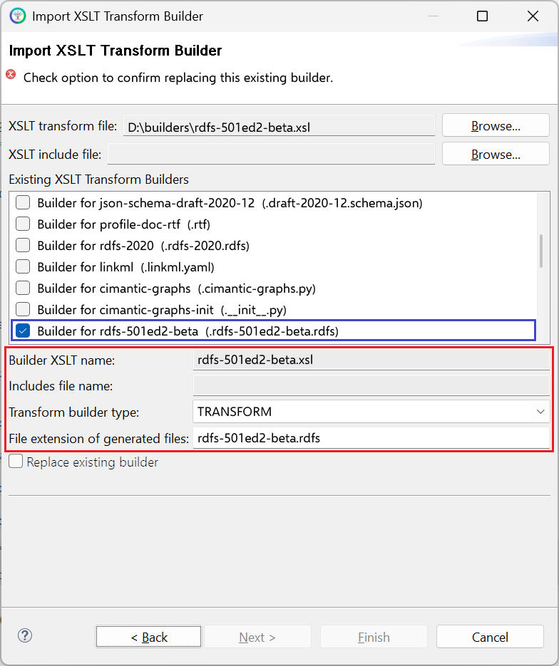

# rdfs-501ed2-beta.xsl

This builder currently ships with CIMTool.

>*NOTE: </br>This builder is a beta. Its output may change in later releases of CIMTool.*

## Builder Description

The **[rdfs-501ed2-beta.xsl](rdfs-501ed2-beta.xsl)** builder is a reference implementation of the RDFS schema defined by the draft **IEC 61970-501 Ed 2.0** specification, for those interested in the format being developed for the standard. Classes, enumerations and CIMDatatypes are declared as ```owl:Class```, attributes as ```owl:DatatypeProperty``` and associations as ```owl:ObjectProperty```. As the draft requires, the generated schema contains no profile constraints; under IEC 61970-501 Ed 2.0 these are defined in a separate artifact as SHACL rules.

For RDFS schemas in the RDFS2020 format use the [rdfs-2020.xsl](../rdfs-2020/builder.md) builder.

Below is an extract generated from a CGMES StateVariables profile:

```xml
   <rdf:Description rdf:about="#SvVoltage">
      <rdf:type rdf:resource="http://www.w3.org/2002/07/owl#Class"/>
      <rdfs:label xml:lang="en">SvVoltage</rdfs:label>
      <skos:definition xml:lang="en">State variable for voltage.</skos:definition>
      <m:Package xmlns:m="http://langdale.com.au/2005/Sample#">Package_StateVariables</m:Package>
   </rdf:Description>
   <rdf:Description rdf:about="#SvVoltage.TopologicalNode">
      <rdf:type rdf:resource="http://www.w3.org/2002/07/owl#ObjectProperty"/>
      <rdf:type rdf:resource="http://www.w3.org/2002/07/owl#FunctionalProperty"/>
      <rdfs:label xml:lang="en">TopologicalNode</rdfs:label>
      <skos:definition xml:lang="en">The topological node associated with the voltage state.</skos:definition>
      <rdfs:domain rdf:resource="#SvVoltage"/>
      <rdfs:range rdf:resource="#TopologicalNode"/>
      <owl:inverseOf rdf:resource="#TopologicalNode.SvVoltage"/>
   </rdf:Description>
   <rdf:Description rdf:about="#SvVoltage.angle">
      <rdf:type rdf:resource="http://www.w3.org/2002/07/owl#DatatypeProperty"/>
      <rdf:type rdf:resource="http://www.w3.org/2002/07/owl#FunctionalProperty"/>
      <rdfs:label xml:lang="en">angle</rdfs:label>
      <skos:definition xml:lang="en">The voltage angle of the topological node complex voltage with respect to system reference.</skos:definition>
      <rdfs:range rdf:resource="#AngleDegrees"/>
      <rdfs:domain rdf:resource="#SvVoltage"/>
   </rdf:Description>
   <rdf:Description rdf:about="#SvVoltage.v">
      <rdf:type rdf:resource="http://www.w3.org/2002/07/owl#DatatypeProperty"/>
      <rdf:type rdf:resource="http://www.w3.org/2002/07/owl#FunctionalProperty"/>
      <rdfs:label xml:lang="en">v</rdfs:label>
      <skos:definition xml:lang="en">The voltage magnitude at the topological node. The attribute shall be a positive value.</skos:definition>
      <rdfs:range rdf:resource="#Voltage"/>
      <rdfs:domain rdf:resource="#SvVoltage"/>
   </rdf:Description>
```

## XSLT Version

This builder is XSLT 2.0 compliant.

## Release History

| CIMTool Release | Release Date | Changes |
|---|---|---|
| [2.3.0](https://cimtool.ucaiug.io/release-notes/) | 08-Jun-2026 | Changed from XSLT 3.0 to XSLT 2.0. URIs are now treated as local only when they start with the profile namespace followed by ```#```, associations take ```rdfs:domain``` from the owning class, and the ```rdfs:domain``` of enumeration values now names the enumeration class, including for enumerations outside the profile namespace. |
| [2.2.0](https://cimtool.ucaiug.io/release-notes/) | 01-Oct-2024 | Added to CIMTool as a beta ([#142](https://github.com/cimug-org/CIMTool/issues/142)). |

## Author

Todd Viegut [@tviegut] on behalf of UCAIug.

## Submission Date

20-Sep-2024

## Builder NTE Configuration

Given this builder ships with CIMTool the below screenshot highlights the existing NTE (Name/Type/Extension) settings for the builder.  We strongly recommend that you do not import customized versions of this shipped builder over the original in your local CIMTool installation. Doing so will force regeneration of any existing builder-generated artifacts for projects in your workspace that have this builder enabled.

The recommended best practice is to rename the builder file  (from ```rdfs-501ed2-beta.xsl``` to ```custom-rdfs-501ed2-beta.xsl``` for example) before importing. On import this will be interpreted as a new builder and you will be allowed to enter values in the Type and Extension fields.

>*NOTE: </br>CIMTool requires that file extensions be unique and will prevent you from entering an extension already assigned to a builder. This is because an artifact's name is derived by concatenating the base name of the CIMTool ```.owl``` profile with the file extension assigned to the builder. Therefore, a unique file extension must be assigned to each builder when imported. The file extension for a builder can be modified later from within the "Maintain XSLT Transform Builders" screen.*



## License

This builder is released under the [Apache 2.0](../../LICENSE) license and was developed under sponsorship of the UCAIug.
