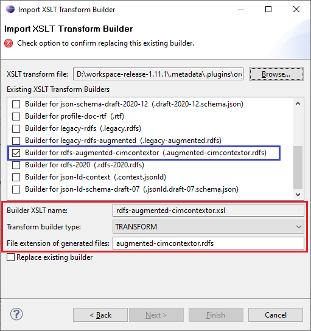

# rdfs-augmented-cimcontextor.xsl

This builder no longer ships with CIMTool.

## Builder Description

The **[rdfs-augmented-cimcontextor.xsl](rdfs-augmented-cimcontextor.xsl)** builder generated an RDFS schema in the format produced by the CimConteXtor and CimSyntaxGen tools, as found in the publicly available ENTSO-E CGMES 2.4.15 RDFS profiles. It is a cross between the [legacy-rdfs-augmented.xsl](../legacy-rdfs-augmented/builder.md) builder and the [rdfs-2020.xsl](../rdfs-2020/builder.md) builder.

This builder shipped with CIMTool 1.12.0 through 2.2.0. The [rdfs-2020.xsl](../rdfs-2020/builder.md) builder now covers this format, and the XSLT is kept in the library for reference only.

## XSLT Version

This builder is XSLT 3.0 compliant.

## Release History

| CIMTool Release | Release Date | Changes |
|---|---|---|
| [2.3.0](https://cimtool.ucaiug.io/release-notes/) | 08-Jun-2026 | Removed from CIMTool. |
| [2.2.0](https://cimtool.ucaiug.io/release-notes/) | 01-Oct-2024 | URIs outside the profile namespace are now written in full, multiplicities are always written as a range (for example ```M:1..1```), and ```rdfs:domain``` is taken from the property's class instead of being parsed from the property URI. Inverse references no longer include ```cims:AssociationUsed```. |
| [2.0.1](https://cimtool.ucaiug.io/release-notes/) | 12-May-2024 | Changed the ```xsd``` namespace declared in the generated RDFS from ```http://www.w3.org/2001/XMLSchema#``` to ```http://www.w3.org/2001/XMLSchema```. |
| [1.12.0](https://cimtool.ucaiug.io/release-notes/) | 21-Feb-2024 | Added to CIMTool ([#80](https://github.com/cimug-org/CIMTool/issues/80)). |

## Author

Todd Viegut [@tviegut] on behalf of UCAIug.

## Submission Date

21-Feb-2024

## Builder NTE Configuration

The below screenshot shows the NTE (Name/Type/Extension) settings this builder had while it shipped with CIMTool (file extension ```augmented-cimcontextor.rdfs```).



## License

This builder is released under the [Apache 2.0](../../LICENSE) license and was developed under sponsorship of the UCAIug.
