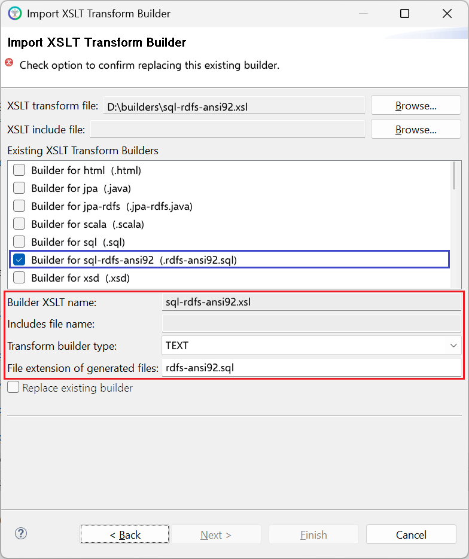

# sql-rdfs-ansi92.xsl

This builder currently ships with CIMTool.

## Builder Description

The **[sql-rdfs-ansi92.xsl](sql-rdfs-ansi92.xsl)** builder generates an ANSI SQL-92 compliant DDL script for RDFS profiles such as CGMES. It produces the same schema as the [sql.xsl](../sql/builder.md) builder (a table per class, separate tables for ```<<Compound>>``` types, enumeration reference tables, and foreign key, inheritance and cascade delete constraints), but gives classes outside the IdentifiedObject hierarchy (for example ```CurveData```) a surrogate ```"id"``` primary key in place of ```"mRID"```, together with a unique constraint over their required columns.

Refer to the comments at the top of the generated script for details of the design and its motivations. The [jpa-rdfs.xsl](../jpa-rdfs/builder.md) and [csharp-ef-rdfs.xsl](../csharp-ef-rdfs/builder.md) builders generate matching Java and C# code.

The following extracts were generated from the same CGMES CoreEquipment profile. With the [sql.xsl](../sql/builder.md) builder, ```CurveData``` (which does not inherit from IdentifiedObject) is given an ```"mRID"``` primary key:

```sql
-- Multi-purpose data points for defining a curve. The use of this generic
-- class is discouraged if a more specific class can be used to specify the
-- X and Y axis values along with their specific data types.
CREATE TABLE "CurveData"
(
    "mRID" VARCHAR(100) PRIMARY KEY,
    -- The data value of the X-axis variable, depending on the X-axis units.
    "xvalue" DOUBLE PRECISION NOT NULL,
    -- The data value of the first Y-axis variable, depending on the Y-axis units.
    "y1value" DOUBLE PRECISION NOT NULL,
    -- The data value of the second Y-axis variable (if present), depending on
    -- the Y-axis units.
    "y2value" DOUBLE PRECISION,
    -- The curve of this curve data point.
    -- FK column reference to table representing the "Curve" class
    "Curve" VARCHAR(100) NOT NULL
);
```

With **sql-rdfs-ansi92.xsl** the same class is given a surrogate ```"id"``` primary key and a unique constraint:

```sql
-- Multi-purpose data points for defining a curve. The use of this generic
-- class is discouraged if a more specific class can be used to specify the
-- X and Y axis values along with their specific data types.
CREATE TABLE "CurveData"
(
    "id" VARCHAR(100) PRIMARY KEY,
    -- The data value of the X-axis variable, depending on the X-axis units.
    "xvalue" DOUBLE PRECISION NOT NULL,
    -- The data value of the first Y-axis variable, depending on the Y-axis units.
    "y1value" DOUBLE PRECISION NOT NULL,
    -- The data value of the second Y-axis variable (if present), depending on
    -- the Y-axis units.
    "y2value" DOUBLE PRECISION,
    -- The curve of this curve data point.
    -- FK column reference to table representing the "Curve" class
    "Curve" VARCHAR(100) NOT NULL
);
...
-- Heuristic uniqueness constraint for non-IdentifiedObject table "CurveData"
ALTER TABLE "CurveData" ADD UNIQUE ("xvalue", "y1value", "Curve");
```

## XSLT Version

This builder is XSLT 3.0 compliant.

## Release History

| CIMTool Release | Release Date | Changes |
|---|---|---|
| [2.3.0](https://cimtool.ucaiug.io/release-notes/) | 08-Jun-2026 | Added to CIMTool ([#217](https://github.com/cimug-org/CIMTool/issues/217)). |

## Author

Todd Viegut [@tviegut] on behalf of UCAIug.

## Submission Date

01-Apr-2026

## Builder NTE Configuration

Given this builder ships with CIMTool the below screenshot highlights the existing NTE (Name/Type/Extension) settings for the builder.  We strongly recommend that you do not import customized versions of this shipped builder over the original in your local CIMTool installation. Doing so will force regeneration of any existing builder-generated artifacts for projects in your workspace that have this builder enabled.

The recommended best practice is to rename the builder file  (from ```sql-rdfs-ansi92.xsl``` to ```custom-sql-rdfs-ansi92.xsl``` for example) before importing. On import this will be interpreted as a new builder and you will be allowed to enter values in the Type and Extension fields.

>*NOTE: </br>CIMTool requires that file extensions be unique and will prevent you from entering an extension already assigned to a builder. This is because an artifact's name is derived by concatenating the base name of the CIMTool ```.owl``` profile with the file extension assigned to the builder. Therefore, a unique file extension must be assigned to each builder when imported. The file extension for a builder can be modified later from within the "Maintain XSLT Transform Builders" screen.*



## License

This builder is released under the [Apache 2.0](../../LICENSE) license and was developed under sponsorship of the UCAIug.
