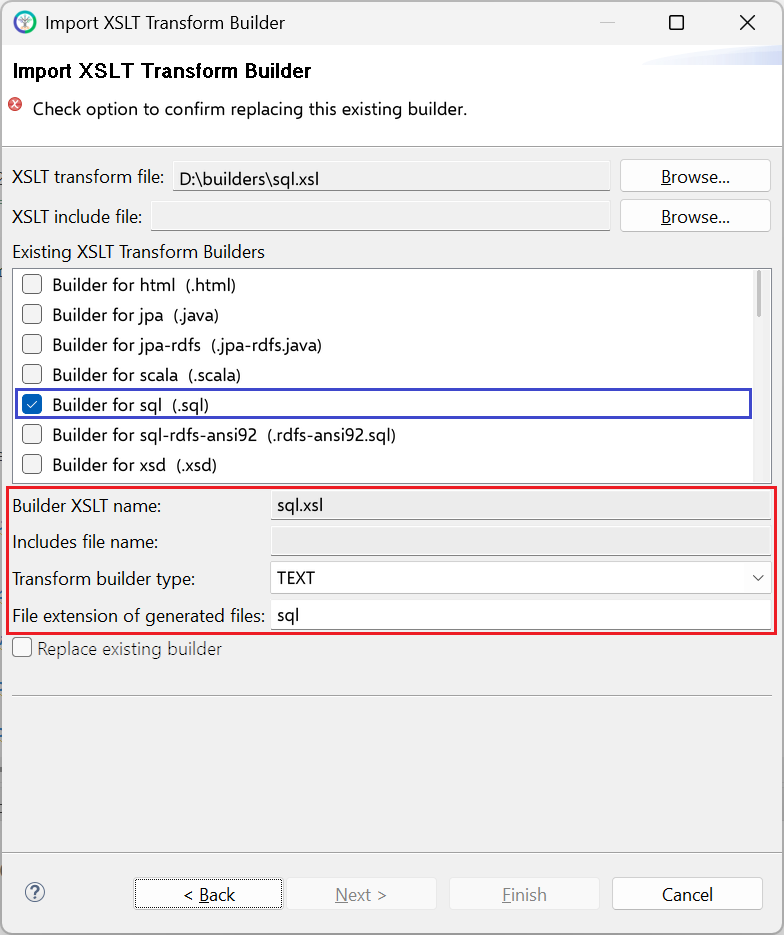

# sql.xsl

This builder currently ships with CIMTool.

## Builder Description

The **[sql.xsl](sql.xsl)** builder generates an ANSI SQL-92 compliant database script that currently conforms to the following subset of ANSI defined database types:

```
{
  VARCHAR (size)
 | SMALLINT
 | INTEGER
 | BIGINT
 | DOUBLE PRECISION
 | DATE
 | TIME
 | TIMESTAMP
 | BLOB
}
```

As of the CIMTool 2.3.0 release, ```sql.xsl``` gives the table for every class an ```"mRID"``` primary key, as for classes in the IdentifiedObject hierarchy, and represents ```<<Compound>>``` types as separate tables with their own ```"id"``` key. Profiles that contain classes outside the IdentifiedObject hierarchy (for example ```CurveData``` in CGMES) should use the [sql-rdfs-ansi92.xsl](../sql-rdfs-ansi92/builder.md) builder instead. The comments at the top of the generated script explain the design of the schema.

A sample extract of a DDL script generated from a ComModuleConfig profile appears next and illustrates the inclusion of comments and descriptions as defined within a **CIMTool** ```owl``` profile:

```sql
-- ANSI-SQL-92 compliant schema for ComModuleConfig
-- Generated by CIMTool https://cimtool.ucaiug.io

...
-- The Name class provides the means to define any number of human readable
-- names for an object. A name is <b>not</b> to be used for defining inter-object
-- relationships. For inter-object relationships instead use the object identification
-- 'mRID'.
CREATE TABLE "Name"
(
    "mRID" VARCHAR(100) PRIMARY KEY,
    -- Any free text that name the object.
    "name" VARCHAR(255) NOT NULL,
    -- Type of this name.
    -- FK column reference to table representing the "NameType" class
    "NameType" VARCHAR(100)
);

-- Type of name. Possible values for attribute 'name' are implementation dependent
-- but standard profiles may specify types. An enterprise may have multiple
-- IT systems each having its own local name for the same object, e.g. a planning
-- system may have different names from an EMS. An object may also have different
-- names within the same IT system, e.g. localName as defined in CIM version
-- 14. The definition from CIM14 is:
-- The localName is a human readable name of the object. It is a free text
-- name local to a node in a naming hierarchy similar to a file directory
-- structure. A power system related naming hierarchy may be: Substation,
-- VoltageLevel, Equipment etc. Children of the same parent in such a hierarchy
-- have names that typically are unique among them.
CREATE TABLE "NameType"
(
    "mRID" VARCHAR(100) PRIMARY KEY,
    -- Description of the name type.
    "description" VARCHAR(255),
    -- Name of the name type.
    "name" VARCHAR(255) NOT NULL,
    -- Authority responsible for managing names of this type.
    -- FK column reference to table representing the "NameTypeAuthority" class
    "NameTypeAuthority" VARCHAR(100)
);

-- Authority responsible for creation and management of names of a given type;
-- typically an organization or an enterprise system.
CREATE TABLE "NameTypeAuthority"
(
    "mRID" VARCHAR(100) PRIMARY KEY,
    -- Description of the name type authority.
    "description" VARCHAR(255),
    -- Name of the name type authority.
    "name" VARCHAR(255) NOT NULL
);

...
-- Foreign keys for table "Name"
ALTER TABLE "Name" ADD FOREIGN KEY ( "NameType" ) REFERENCES "NameType" ( "mRID" );

-- Foreign keys for table "NameType"
ALTER TABLE "NameType" ADD FOREIGN KEY ( "NameTypeAuthority" ) REFERENCES "NameTypeAuthority" ( "mRID" );
...
-- Foreign key column indexes for optimized queries and joins
...
CREATE INDEX ix_Name_NameType ON "Name" ( "NameType" );
CREATE INDEX ix_NameType_NameTypeAuthority ON "NameType" ( "NameTypeAuthority" );
```

## XSLT Version

This builder is XSLT 2.0 compliant.

## Release History

| CIMTool Release | Release Date | Changes |
|---|---|---|
| [2.3.0](https://cimtool.ucaiug.io/release-notes/) | 08-Jun-2026 | Upgraded to XSLT 2.0. ```<<Compound>>``` types are now generated as separate tables, and the script adds inheritance, cascade delete and foreign key index sections with an expanded set of SQL types ([#217](https://github.com/cimug-org/CIMTool/issues/217), [#241](https://github.com/cimug-org/CIMTool/issues/241)). |
| [2.1.0](https://cimtool.ucaiug.io/release-notes/) | 09-Aug-2024 | Updated the CIMTool web address in the generated script header. |
| [1.10.0](https://cimtool.ucaiug.io/release-notes/) | 26-Aug-2022 | Earliest release in the CIMTool GitHub repository. The builder shipped with earlier releases of CIMTool. |

## Author

Arnold deVos on behalf of UCAIug.

## Submission Date

21-Jan-2009

## Builder NTE Configuration

Given this builder ships with CIMTool the below screenshot highlights the existing NTE (Name/Type/Extension) settings for the builder.  We strongly recommend that you do not import customized versions of this shipped builder over the original in your local CIMTool installation. Doing so will force regeneration of any existing builder-generated artifacts for projects in your workspace that have this builder enabled.

The recommended best practice is to rename the builder file  (from ```sql.xsl``` to ```custom-sql.xsl``` for example) before importing. On import this will be interpreted as a new builder and you will be allowed to enter values in the Type and Extension fields.

>*NOTE: </br>CIMTool requires that file extensions be unique and will prevent you from entering an extension already assigned to a builder. This is because an artifact's name is derived by concatenating the base name of the CIMTool ```.owl``` profile with the file extension assigned to the builder. Therefore, a unique file extension must be assigned to each builder when imported. The file extension for a builder can be modified later from within the "Maintain XSLT Transform Builders" screen.*



## License

This builder is released under the [Apache 2.0](../../LICENSE) license and was developed under sponsorship of the UCAIug.
